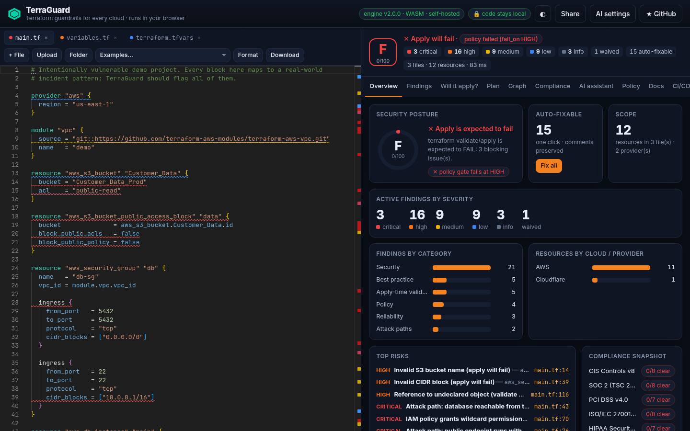
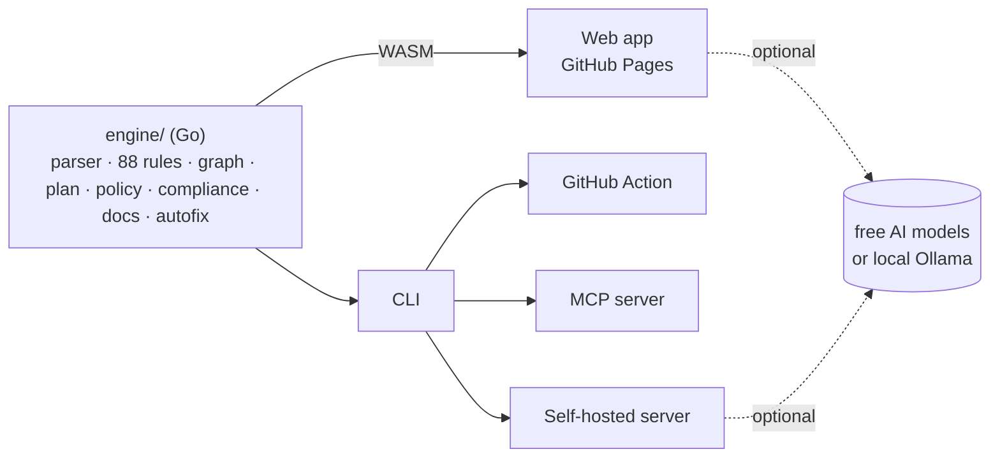

# 🛡️ TerraGuard

**Catch Terraform problems before `apply` does, on every cloud.** TerraGuard
finds security misconfigurations, apply-time failures, attack paths, risky
plans, cost traps and compliance gaps. It runs in your browser, your terminal,
your CI, your AI agent or your own server, all from one Go engine. It's open
source and costs **$0**.

[](https://github.com/Karthik-099/TERRAGUARD/actions/workflows/ci.yml)
[](https://karthik-099.github.io/TERRAGUARD/)
[](go.mod)
[](LICENSE)
[](CONTRIBUTING.md)

### ▶ [Open the web app](https://karthik-099.github.io/TERRAGUARD/): no install, no signup, your code never leaves the browser



---

## Why

- `plan` was green, then `apply` failed on a bucket name with an underscore, or on a deprecated Lambda runtime.
- A PR quietly replaced the production database because `identifier` changed.
- Each resource looked fine, but together they made a public Lambda running as admin.
- SSH was open to `0.0.0.0/0` on a DigitalOcean droplet, a Hetzner server and an OVH instance, because every cloud spells "firewall" differently.
- The state file was committed to git. The S3 backend had no locking, and two applies corrupted it.
- A CNAME still pointed at a deleted Heroku app (subdomain takeover).
- The security exception was approved in Slack 8 months ago, and nobody remembers why.

TerraGuard finds these in milliseconds, explains them, and fixes many automatically.

## Features

| | |
|---|---|
| **Will it apply?** | Syntax, duplicates, undeclared references, `count`+`for_each`, invalid CIDRs, S3 bucket names, port ranges, deprecated runtimes, missing tfvars. No `terraform init` needed |
| **88 rules · 14 providers** | AWS · Google Cloud · Azure · Cloudflare · DigitalOcean · Hetzner · Akamai/Linode · OVHcloud/OpenStack · Oracle Cloud · Alibaba · Vultr · Kubernetes · Helm, plus provider-agnostic checks |
| **Attack paths** | Graph analysis: internet → open SG → public DB; public Lambda → admin role; exposed VM → admin profile |
| **Plan risk** | `terraform show -json`: destroys/replaces of stateful resources, *with the attribute that forced it* |
| **State & supply chain** | Unencrypted or unlocked backends, committed `*.tfstate`, unpinned providers, modules and Helm charts, mutable images |
| **DNS / CDN** | Subdomain-takeover CNAMEs, DNSSEC, CloudFront / Azure CDN / Cloudflare TLS |
| **Cost** | gp2 → gp3 (auto-fix), previous-gen instances, infinite log retention |
| **Auto-fix** | One click or `terraguard fix`. Edits the syntax tree, keeps comments, warns on forced replacement |
| **Policy-as-code** | `.terraguard.yml`: thresholds, overrides, custom rules, **expiring waivers with an approver** |
| **Compliance** | Indicative mapping to CIS v8, SOC 2, PCI DSS 4.0, ISO 27001:2022, HIPAA |
| **Docs** | terraform-docs style README (inputs, outputs, providers, resources) |
| **CI/CD & GitOps** | GitHub Action (SARIF annotations, sticky PR comment, gate) and a pipeline generator (OIDC plan → gate → approved apply) |
| **MCP server** | `terraguard mcp`: Claude Code / Cursor scan, fix and document Terraform |
| **Self-hosting** | `terraguard serve` or Docker: one binary, keys stay server-side, optional bundled local LLM |
| **Live stats** | Public dashboard: Terraform files checked today, resources analyzed, issues, fixes, active users (anonymous counts only) |
| **AI (optional)** | Explain, remediate, rewrite, generate tests and modules, cost review, plan explanation. Free models with automatic fallback, or fully local |

## Quick start

**Web app:** open **https://karthik-099.github.io/TERRAGUARD/**, paste Terraform or drop a folder.

**CLI**

```bash
go install github.com/Karthik-099/TERRAGUARD/cmd/terraguard@latest
terraguard scan .                       # report; exit 1 if the policy fails
terraguard scan . --plan plan.json      # + plan risk analysis
terraguard fix .                        # safe auto-fixes
terraguard docs . > README.md           # module docs
terraguard ask "what's the riskiest thing here?"   # optional AI
```

**GitHub Action**

```yaml
on:
  pull_request:
    paths: ["**/*.tf", "**/*.tfvars", ".terraguard.yml"]   # only when Terraform changes
permissions: { contents: read, pull-requests: write, security-events: write }
jobs:
  terraguard:
    runs-on: ubuntu-latest
    steps:
      - uses: actions/checkout@v4
      - uses: Karthik-099/TERRAGUARD@main
        with: { path: infra, fail-on: HIGH }
```

The web app's **CI/CD** tab generates a full pipeline: fmt → validate → OIDC plan → TerraGuard gate → approved apply.

**Self-host (private)**

```bash
git clone https://github.com/Karthik-099/TERRAGUARD && cd TERRAGUARD
cp .env.example .env     # free keys, a local model, or nothing
make serve               # http://127.0.0.1:8080
# or: docker compose --profile local-llm up -d   (bundled Ollama, nothing leaves your network)
```

**MCP:** `claude mcp add terraguard -- terraguard mcp`

## Is AI required? No.

Scanning, validation, plan analysis, auto-fix, policy, compliance, docs and the
CI gate are deterministic, so they're free, offline and reproducible. The AI
only gives **responses and suggestions** and never decides pass/fail.

When you do use it, TerraGuard routes across **free** models and falls back
automatically if one is rate-limited or down:

```
groq: gpt-oss-120b → llama-3.3-70b → gpt-oss-20b
  → openrouter: nemotron :free → gemma :free → openrouter/free (any live free model)
  → gemini: 2.5-flash → 2.5-flash-lite
  → your local Ollama / LM Studio
```

| Provider | Free key | Cost |
|---|---|---|
| Groq | https://console.groq.com/keys | $0 free tier |
| OpenRouter | https://openrouter.ai/keys | $0 (`:free` models only) |
| Google Gemini | https://aistudio.google.com/apikey | $0 free tier |
| Ollama (local) | https://ollama.com/download | $0, runs on your machine |

For **full privacy**, set `TERRAGUARD_AI_LOCAL_ONLY=true` (or tick **Private
mode** in the web app). Hosted providers are then never called, and your code
never leaves your machine. See [docs/SELF_HOSTING.md](docs/SELF_HOSTING.md).

## Cost: $0

| Piece | Runs on | Cost |
|---|---|---|
| Web app | GitHub Pages | $0 |
| CI gate, SARIF, PR comments | GitHub Actions (public repo) | $0 |
| AI | Groq / OpenRouter free / Gemini free / local Ollama | $0 |
| Self-hosted server | Your machine | $0 |
| Live stats counters (optional) | Cloudflare Workers free plan | $0, and skippable |

## Architecture



The full HLD/LLD, every application and pipeline, the AI routing, the stats
dashboard, and the security and privacy model are in
**[docs/ARCHITECTURE.md](docs/ARCHITECTURE.md)**.

## Develop

```bash
make test        # Go vet + unit tests (engine, AI router, server, stats)
make evals       # 43 labelled cases: 100% recall/precision gate
make serve       # full app locally
make secrets     # fail if any credential is tracked
```

## Contributing

Rules, false-positive reports, new providers and ideas are all welcome. See
**[CONTRIBUTING.md](CONTRIBUTING.md)**. A new rule is about 20 lines of Go plus
two eval cases, and it shows up everywhere automatically.

- 💬 [Discussions](https://github.com/Karthik-099/TERRAGUARD/discussions)
- 💡 [Suggest a rule](https://github.com/Karthik-099/TERRAGUARD/issues/new?template=rule_request.yml)
- 🐞 [Report a false positive](https://github.com/Karthik-099/TERRAGUARD/issues/new?template=false_positive.yml)

## License

[MIT](LICENSE) © Karthik
