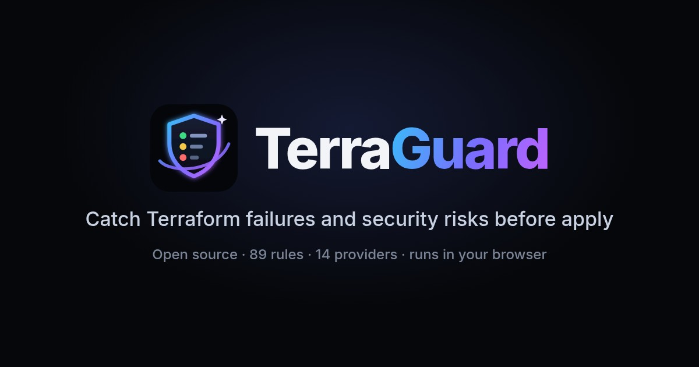
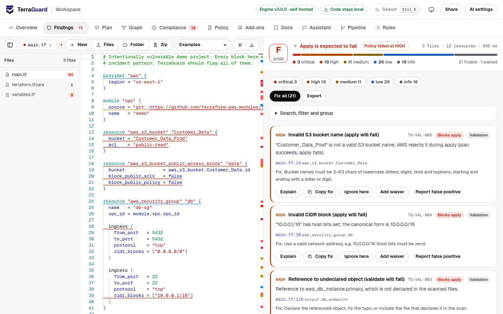
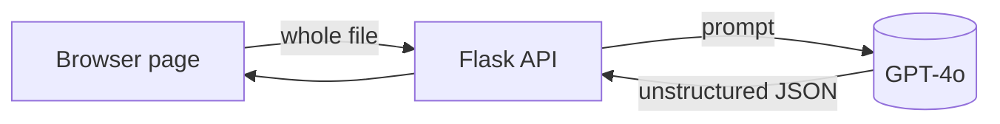

<p align="center"></p>

# TerraGuard

**Catch infrastructure failures and security risks before they ship.**

TerraGuard checks Terraform and OpenTofu, Kubernetes manifests (and Helm and
Kustomize), CloudFormation and SAM, Serverless Framework, Azure ARM and Bicep,
Dockerfiles, docker-compose, Ansible, OpenAPI, Pulumi, Crossplane, OpenShift and
CI pipelines (GitHub Actions, GitLab, Azure Pipelines, CircleCI, Bitbucket) for
misconfigurations, leaked secrets, apply-time errors, destructive changes and
cost, on public clouds and on private ones: Nutanix, VMware vSphere and Red Hat
OpenShift (ROSA, ARO and self-managed). It explains every finding, fixes many of
them automatically, and enforces your organization's standards as code. One Go
engine runs in the browser, the editor, the terminal, CI, AI agents, your own
server and as a Kubernetes admission controller. It is open source and costs
nothing to run.

[](https://github.com/Karthik-099/TERRAGUARD/actions/workflows/ci.yml)
[](https://karthik-099.github.io/TERRAGUARD/)
[](go.mod)
[](LICENSE)
[](https://scorecard.dev/viewer/?uri=github.com/Karthik-099/TERRAGUARD)

**[Open the web app](https://karthik-099.github.io/TERRAGUARD/)**: no install, no signup, your code stays in the browser.



## New in 3.0

- **Private cloud and Red Hat.** Nutanix (Prism Central, Flow, NKE, CAPX cluster manifests), VMware vSphere, and Red Hat OpenShift: Routes, SecurityContextConstraints, BuildConfigs, OAuth, ROSA (`rhcs` provider) and ARO. RHEL, Rocky and Alma container images in `terraguard vuln`.
- **Secret scanning.** 15 `TG-SECRET-*` rules for cloud keys, Git and chat tokens, private keys, JWTs and high-entropy passwords in every file, with values redacted in every output and unwaivable in the recommended pack.
- **Teams.** CODEOWNERS on every finding, `scan --group-by owner`, per-owner Pulse tables; drop a whole folder or zip into the web app and scan it at once.
- **Plugins and add-ons.** Any executable named `terraguard-<name>` adds findings to a scan (`terraguard plugins`); custom rules can be written, tested and shared from the web app.
- **Supply chain.** `terraguard sbom` (CycloneDX, offline), `vuln --sbom`, signed checksums, CycloneDX and SPDX SBOMs and provenance on every release.
- **Hardening.** Remote policy `extends` are https-only, size- and time-limited and refused with `TERRAGUARD_OFFLINE=true`; local `extends` cannot leave the working folder; the local UI and server refuse cross-origin and DNS-rebinding requests.

See [CHANGELOG.md](CHANGELOG.md) for everything, and [ROADMAP.md](ROADMAP.md) for what is next.

---

## Contents

- [New in 3.0](#new-in-30)
- [The problem](#the-problem)
- [What TerraGuard does](#what-terraguard-does)
- [Quick start](#quick-start)
- [Architecture: phase 1, phase 2, phase 3](#architecture-phase-1-phase-2-phase-3)
- [Policy-as-code](#policy-as-code)
- [How AI is used](#how-ai-is-used)
- [Integrations](#integrations)
- [Comparison with existing tools](#comparison-with-existing-tools)
- [Performance](#performance)
- [Documentation](#documentation)
- [Contributing](#contributing)

---

## The problem

Terraform runs in stages, and every stage has a failure mode that is usually
discovered too late:

| Stage | What goes wrong | How TerraGuard helps |
|---|---|---|
| **Write** | Public buckets, open security groups, wildcard IAM, hardcoded secrets, unpinned modules | Diagnostics on save, 1,750 rules with exact lines and fixes, verified AI fixes |
| **Init** | Unpinned providers; local, unencrypted or unlocked state; committed `*.tfstate` | Pinning, backend and state-file checks |
| **Validate** | `terraform validate` needs init and credentials, and misses provider-side errors | Syntax, reference and apply-time checks with no init |
| **Plan** | A destroy or replace of a database hides in a long plan | Plan risk with the attribute that forced replacement; rules on resolved values |
| **Review** | Legacy findings drown new ones; standards differ per reviewer; exceptions live in chat | Diff-aware review, policy-as-code, waivers with approver and expiry |
| **Apply** | Partial failures, data loss, no gate | Will-it-apply verdict, policy gate, GitOps pipeline with approval |
| **Operate** | Drift, audits, no view of who follows the standards | Pulse adoption reports, compliance mapping, opt-in drift detection |

## Formats

| Format | Read from | Notes |
|---|---|---|
| Terraform, OpenTofu | `.tf`, `.tofu`, `.tf.json`, `.tfvars`, `terragrunt.hcl`, plan JSON | Variables, locals, tfvars and Terragrunt inputs resolved; bundled AWS, Azure and Google schemas |
| Kubernetes | YAML or JSON manifests; Helm charts with `--helm`; Kustomize with `--kustomize` | Every Kubernetes rule runs on manifests and on the Terraform kubernetes provider alike |
| CloudFormation, SAM | YAML or JSON templates | Parameter defaults resolved, intrinsic functions understood, SAM Globals applied |
| Serverless Framework | `serverless.yml` | Functions inherit provider settings; `resources` read as CloudFormation |
| Azure ARM, Bicep | ARM JSON; `.bicep` with `--bicep` | Parameters, variables and common functions evaluated; nested and child resources |
| Dockerfile | `Dockerfile`, `*.dockerfile`, `Containerfile` | Multi-stage builds; only shipped stages judged where it matters |
| docker-compose | `docker-compose*.yml`, `compose.yml` | Services, volumes, networks |
| CI pipelines | GitHub Actions, GitLab CI, Azure Pipelines, CircleCI, Bitbucket | Script injection, unpinned actions, write-all tokens, `pull_request_target` checkouts |
| Ansible | Playbooks and task files | Cloud modules, shell and download hygiene |
| OpenAPI | 2.0 and 3.x, YAML or JSON | Security schemes, transport, input limits |
| Pulumi, Crossplane, Deployment Manager | `Pulumi.yaml`, stack exports, Crossplane managed resources, GDM configs | Mapped to the matching Terraform types so the same rules apply |
| OpenShift | Routes, SCCs, BuildConfigs, ImageStreams, OAuth, DeploymentConfigs | DeploymentConfigs also get every Kubernetes pod rule |
| Nutanix, vSphere, Red Hat | `nutanix`, `vsphere`, `rhcs` and `azurerm_redhat_openshift_cluster` resources; CAPX manifests | Provider TLS, VM hardening, Flow policies, ROSA and ARO exposure and encryption |
| Any file | Every text file in the scan | Secret scanning; secret-bearing files (`.env`, `*.pem`, `id_rsa`, `kubeconfig`) flagged by name and never read |

Files of other kinds are skipped. `--framework kubernetes,dockerfile` limits a
scan to some formats.

## What TerraGuard does

| Capability | Details |
|---|---|
| **Will it apply?** | Syntax, duplicates, undeclared references, `count` + `for_each`, invalid CIDRs, S3 bucket names, port ranges, deprecated Lambda runtimes, missing tfvars, unknown or missing provider arguments, and values the AWS API rejects (1,322 arguments checked against the published API models). No `terraform init`. |
| **Security and correctness rules** | 1,750 rules across every format above and 26 cloud and platform providers |
| **Cost** | `terraguard cost`: offline monthly estimate for AWS, Azure and Google Cloud, usage-based charges from a usage file, your own negotiated prices, a budget gate, and the change shown in every pull request |
| **Your own policies** | YAML rules in `.terraguard.yml`, graph policies in Checkov's YAML format, Rego (Conftest style), plain-English drafts |
| **Coverage** | Every resource with the number of checks that ran on it, which passed and which failed, and the resource types no rule is written for, in the CLI (`--coverage`), the report and the workspace |
| **Any editor** | `terraguard lsp`: diagnostics and quick fixes over the Language Server Protocol for Neovim, JetBrains, Zed, Helix, Emacs and Sublime; a VS Code extension too |
| **Kubernetes admission** | `terraguard serve` validates objects at `/api/k8s/validate` with the same rules, so the cluster refuses what CI would |
| **Attack paths** | Cross-resource graph checks, e.g. a public Lambda running as an admin role |
| **Plan risk** | Destroys and replaces of stateful resources, with the forcing attribute |
| **Auto-fix** | Syntax-tree edits that keep comments; `terraguard fix` |
| **Verified AI fixes** | `terraguard agent`: the AI proposes, the engine re-scans, and a change is kept only if it measurably reduces risk |
| **Diff-aware review** | `terraguard review`: only what a PR introduces or resolves, with a risk tier |
| **Policy-as-code** | Custom rules with `where` / `assert`, `extends` packs, risk budgets, baselines, expiring waivers, owners, policy tests, JSON Schema |
| **Pulse** | Control adoption, waiver inventory and trend across many modules |
| **Compliance** | Indicative mapping to CIS v8, SOC 2, PCI DSS 4.0, ISO 27001:2022, HIPAA |
| **Docs for humans and agents** | `terraguard docs` (README) and `terraguard agents-md` (AGENTS.md) |
| **Secrets** | 15 `TG-SECRET-*` rules across every file; values are shown as the first four characters only |
| **Owners** | CODEOWNERS on every finding; `scan --group-by owner`; owner tables in Pulse, SARIF and Markdown |
| **Plugins** | `terraguard-<name>` executables on PATH add findings through JSON or SARIF; waivers and the gate apply to them |
| **Vulnerabilities and SBOM** | `terraguard vuln`: offline OSV scan of lockfiles, container image tarballs (Debian, Ubuntu, Alpine, RHEL, Rocky, Alma) and CycloneDX SBOMs; `terraguard sbom` writes one |
| **Drift and inventory** | `terraguard drift --state` compares code with state; `--live` runs a read-only refresh-only plan |
| **Outputs** | Text, JSON, SARIF, JUnit, Checkstyle, GitLab Code Quality, GitHub annotations, Azure DevOps, Markdown, Mermaid and DOT graphs |

## Quick start

```bash
# Install (or use Docker below)
go install github.com/Karthik-099/TERRAGUARD/cmd/terraguard@latest

terraguard init                           # policy (recommended pack), CI workflow and pre-commit in one step
terraguard scan .                         # report; exit code 1 when the policy fails
terraguard scan . --coverage              # every resource: how many checks ran, which failed
terraguard scan . --watch                 # rescan on every save
terraguard ui .                           # the workspace on your machine, folder loaded from disk
terraguard explain TG-AWS-S3-001          # why a rule exists and how to fix it
terraguard doctor                         # check the install, the policy and optional tools
terraguard cost --plan plan.json          # monthly cost change of a plan
terraguard scan . --plan plan.json        # add plan risk analysis
terraguard fix .                          # deterministic auto-fixes
terraguard agent . --write                # plus AI fixes, each verified by the engine
terraguard review --base origin/main .    # judge only what this branch introduces
terraguard pulse ./infra                  # adoption and waivers across many modules
terraguard docs . > README.md             # module documentation
terraguard agents-md . > AGENTS.md        # instructions for AI coding agents
terraguard policy test policies/tests     # unit-test your own policy

# Docker, no Go required
docker run --rm -v "$PWD:/src" -w /src ghcr.io/karthik-099/terraguard scan .
```

Exit codes: `0` passed, `1` the policy gate failed, `2` usage or runtime error.

## Architecture: phase 1, phase 2, phase 3

### Phase 1: AI-only MVP (April 2026)



It proved that developers want structured, severity-ranked findings with
fixes. But it could not be trusted as a gate:

- Each scan cost money and sent the code to a third party.
- Findings and line numbers changed between runs.
- It needed a server and an API key, and handled one file at a time.
- There were no plans, policies or fixes.

### Phase 2: deterministic engine (now)


- **One engine, many surfaces.** The browser, editor, CLI, CI, agents and server all produce the same result for the same input.
- **The engine decides.** The AI explains and proposes. `engine.Verify` accepts a change only if apply still works, no new medium-or-higher issue appears, and the risk weight goes down.
- **No backend to run.** The public site is static and the engine runs in the browser as WebAssembly.

### Phase 3: platform (3.0)

- Done: provider schema checks, local module inputs, AWS, Azure and Google value checks, a language server, Rego, plan cost.
- Done in 3.0: private clouds (Nutanix, vSphere), Red Hat OpenShift, secret scanning, code owners, plugins, SBOM, offline mode.
- Next: see [ROADMAP.md](ROADMAP.md).

The full HLD and LLD are in [docs/ARCHITECTURE.md](docs/ARCHITECTURE.md). For a guided tour, read [docs/ACADEMY.md](docs/ACADEMY.md).

## Policy-as-code

```yaml
# .terraguard.yml
# yaml-language-server: $schema=https://raw.githubusercontent.com/Karthik-099/TERRAGUARD/main/schema/terraguard.schema.json
extends: [https://example.com/org-baseline.yml]   # inherit an organization baseline
fail_on: MEDIUM
max_findings: { HIGH: 0, MEDIUM: 10 }             # risk budget
severity_overrides: { "TG-AWS-RDS-*": CRITICAL }  # globs everywhere
disable: ["TG-CF-*"]

custom_rules:
  - id: ORG-PROD-001
    title: Production databases are multi-AZ with 14+ days of backups
    owner: data-platform
    docs_url: https://wiki.example.com/standards/databases
    resource_types: [aws_db_instance, aws_rds_cluster]
    where:  [{ attribute: tags.env, equals: prod }]
    assert:
      - { attribute: multi_az, equals: true }
      - { attribute: backup_retention_period, min: 14 }

waivers:
  - rule: ORG-EC2-001
    resource: aws_instance.legacy_batch
    reason: Pinned to m5 until the Q1 migration
    approved_by: payments-lead
    expires: "2027-03-31"        # expired waivers re-activate the finding
```

| Feature | Use it to |
|---|---|
| `extends` | Layer organization, platform and team policies (local paths or https) |
| `where` / `assert` | Scope a rule (e.g. production only) and require several conditions |
| Operators | `exists`, `equals`, `not_equals`, `in`, `not_in`, `matches`, `not_matches`, `contains`, `min`, `max` |
| `max_findings` | Gate on counts and tighten gradually |
| `scan --write-baseline` / `--baseline` | Adopt on an existing codebase: only new findings fail |
| `review --base` | Gate pull requests on what they introduce |
| Waivers | Exceptions with a reason, an approver and an expiry; inline `# terraguard:ignore` too |
| `owner`, `docs_url` | Route every finding to the team that owns the standard |
| `policy validate`, `policy test` | Check the policy and unit-test it with fixtures |
| JSON Schema | Autocomplete and validation in any editor |

A complete example lives in [examples/policies](examples/policies).


### Policy packs

```yaml
# .terraguard.yml
extends: [terraguard:recommended]   # or terraguard:strict, terraguard:minimal
```

| Pack | Gate | Exceptions |
|---|---|---|
| `minimal` | CRITICAL and changes that will not apply | As written in your policy |
| `recommended` | HIGH | Waivers expire within 90 days; leaked secrets and committed state cannot be waived |
| `strict` | MEDIUM | Waivers expire within 30 days, no inline ignores; public data, wildcard IAM, privileged workloads and script injection cannot be waived |

Your own settings override the pack. Packs resolve everywhere, the browser included.

### Editors

VS Code: the TerraGuard extension. Any other editor: point its LSP client at
`terraguard lsp`. Neovim: the plugin in [editors/nvim](editors/nvim) (`require("terraguard").setup()`). JetBrains: LSP4IJ, see [editors/jetbrains](editors/jetbrains).

Diagnostics follow your policy; findings with a safe fix offer it as a quick fix.

### What blocks a merge

A change fails the gate when it will not apply (blocking findings) or adds an
active finding at or above `fail_on` (default HIGH). Lower severities, rules
newer than your `rules_version`, baselined debt, waived findings and, in
`review`, anything that already existed on the base branch are reported but do
not block. See [the gate](docs/REFERENCE.md#what-the-gate-fails-on-and-what-it-leaves-out).

### Coming from Checkov, Trivy or TFLint

Existing `checkov:skip=` and `trivy:ignore:` comments keep working: every
Checkov Terraform check ID maps to the TerraGuard rule that covers it. Your own
graph policies in Checkov's YAML format run with `--policy-dir` (or
`--external-checks-dir`), and Conftest-style Rego policies (`deny`, `violation`,
`warn`) run with `--rego`, against the code or a plan. `--check`, `--skip-check`, `--skip-path`
and `--var-file` behave like the flags you know. Output formats include SARIF
(with stable fingerprints), JUnit, Checkstyle, GitLab Code Quality, GitHub
annotations and Azure DevOps.

### OpenTofu and Terragrunt

Terraform JSON (`.tf.json`, as CDKTF writes) is read too, with findings on the
JSON lines. `--include-modules` also scans modules that `terraform init`
downloaded. `.tofu` files are read with OpenTofu's precedence, and `terragrunt.hcl`
`inputs` feed variable values, so insecure inputs are caught. Terragrunt
`remote_state` is checked for encryption and locking.

### Quota preflight

```bash
terraguard preflight --plan plan.json --live   # read-only cloud access
```

Quotas and global names (like S3 buckets) are only enforced when resources are
created, so a clean plan can still fail halfway through apply. Preflight counts
what the plan needs per quota, compares it with live limits and usage, and
checks that new bucket names are free and that the CI role has the IAM
permissions the creates, deletes and replacements need. It is opt-in and
separate from the deterministic gate. See [Guarantees and limits](docs/LIMITS.md).

### Cost of a plan

```bash
terraguard cost --plan plan.json --fail-above 500   # before and after a plan
terraguard cost .                                   # from the code, no plan needed
terraguard cost --plan plan.json --usage usage.yml --prices negotiated.yml
```

Estimates monthly charges before and after the plan for AWS, Azure and Google
Cloud (instances and VMs, node pools, databases, caches, disks, NAT gateways,
load balancers, Kubernetes control planes, App Service plans and more) at
bundled list prices, offline and without an API key. Usage-based charges (S3
and Blob storage, Lambda and Functions, DynamoDB, requests, logs, data
transfer) are priced from a usage file:

```yaml
resource_usage:
  aws_lambda_function.api: { monthly_requests: 10000000, request_duration_ms: 120 }
  aws_s3_bucket.logs: { storage_gb: 500 }
resource_type_default_usage:
  aws_nat_gateway: { monthly_data_processed_gb: 200 }
```

`--prices` overrides any bundled price (for example `aws.nat_gateway.hour: 0.04`)
for negotiated rates. Scans with `--plan` add the estimate to the report and the
pull request comment.

### Desktop workspace

```bash
terraguard ui ~/code/platform
```

Opens the full workspace in your browser with the folder loaded from disk: no
upload, nothing else to install, the same on Linux, macOS and Windows. It
listens on loopback only, needs a one-time token, never writes files, and
reloads when you switch back to the window.

### Kubernetes admission controller

```bash
terraguard serve --addr 0.0.0.0:8443 --tls-cert tls.crt --tls-key tls.key --admission-policy .terraguard.yml
```

Register `https://<host>:8443/api/k8s/validate` in a
`ValidatingWebhookConfiguration`. Objects with findings at or above
`TERRAGUARD_ADMISSION_FAIL_ON` (default HIGH) are refused with the reasons;
lower findings come back as warnings that `kubectl` prints. Set
`TERRAGUARD_SERVER_TOKEN` to require a bearer token.

### Provider schema checks

Checks every argument and block against what the provider accepts: typos (with
a "did you mean"), read-only and missing arguments, block limits, deprecations.
Schemas for AWS, Azure and Google Cloud are bundled, so this runs with no
`terraform init`; it applies only when the module's version constraint and lock
file allow the bundled version, and skips resources served by another provider
such as `google-beta`. For other providers or versions:

```bash
terraform providers schema -json > schema.json
terraguard scan . --schema schema.json
```

### Standards in plain English

```bash
terraguard policy suggest "every production database keeps 14 days of backups"
```

AI drafts one rule; the engine accepts exactly one custom rule with known
fields (no waivers, disables or threshold changes), rejects built-in IDs and
rules that would match everything, dry-runs it, and lists what it would flag.
Only resource type names are sent to the model, never code. The same flow is in
the workspace's Policy tab.
## How AI is used

AI is **optional**, and it never decides pass or fail.

| Used for | Not used for |
|---|---|
| Explaining a finding and its impact | Gating CI |
| Proposing fixes the rules cannot make (verified by the engine) | Judging its own fixes |
| Generating `terraform test` files and modules | Any change without your review |
| Summarizing a plan or a full-tier review | |

Measured on the demo project with a free Groq model: deterministic fixes took
the risk weight from **224 to 123**, and one verified AI fix took it to **24**.
A second AI proposal was **rejected** by the engine because it introduced a
new issue.

| Provider | Free key | Cost |
|---|---|---|
| Groq | https://console.groq.com/keys | Free tier |
| OpenRouter | https://openrouter.ai/keys | `:free` models |
| Google Gemini | https://aistudio.google.com/apikey | Free tier |
| Ollama, LM Studio, vLLM | https://ollama.com/download | Local; nothing leaves your machine |

Enterprises can bring any model: OpenAI, Anthropic, Azure OpenAI, AWS
Bedrock or Google Vertex through a gateway, or any OpenAI-compatible endpoint
with custom auth headers. Paid providers are used only when explicitly
chosen. TerraGuard falls back across models and providers automatically. Set
`TERRAGUARD_AI_LOCAL_ONLY=true`, or turn on Private mode in the web app, to
never call a public AI service.

## Integrations

| Where | How |
|---|---|
| Browser | [Web app](https://karthik-099.github.io/TERRAGUARD/) (WebAssembly, offline after load) |
| VS Code | `editors/vscode`: diagnostics on save, quick fixes. `.vsix` attached to each release |
| Neovim, JetBrains, any LSP editor | `terraguard lsp`; [editors/nvim](editors/nvim), [editors/jetbrains](editors/jetbrains) |
| Plugins | `terraguard-<name>` executables, see [docs/PLUGINS.md](docs/PLUGINS.md) |
| pre-commit | `.pre-commit-hooks.yaml`: hooks `terraguard` and `terraguard-fix` |
| GitHub Actions | `uses: Karthik-099/TERRAGUARD@v3.0.1` with `command: scan`, `review` or `pulse` |
| GitLab CI | [templates/gitlab-ci.yml](templates/gitlab-ci.yml): Code Quality and JUnit in the merge request |
| Jenkins | [templates/Jenkinsfile](templates/Jenkinsfile) |
| Any CI | JSON, SARIF, JUnit or Markdown output; exit codes |
| AI agents | `terraguard mcp` (local, stdio) or `/mcp` on `terraguard serve` (remote, HTTP, token-protected): tools `scan_terraform`, `fix_terraform`, `generate_docs`, `generate_agents_md`, `validate_rule`, `list_rules` |
| Platform | `terraguard serve`: web app plus HTTP API (`/api/scan`, `/api/fix`, `/api/ai/chat`, `/api/stats`, `/metrics`, remote MCP at `/mcp`), Docker image on GHCR |
| AWS, Azure, Google Cloud | [deploy/](deploy): private deployments (ECS Fargate, Container Apps, Cloud Run) and a Helm chart; CI templates for CodeBuild, Azure Pipelines, Cloud Build, Bitbucket, CircleCI and Atlantis in [templates/](templates) |

The pipeline generator in the web app creates a full GitHub Actions workflow:
fmt, validate, OIDC plan, TerraGuard gate, approval and apply.

## Comparison with existing tools

| | TerraGuard | Checkov | Trivy (tfsec) | TFLint | `terraform validate` |
|---|---|---|---|---|---|
| Runs in the browser, no install | Yes | No | No | No | No |
| Formats | Terraform, OpenTofu, Kubernetes, Helm, Kustomize, CloudFormation, SAM, Serverless, ARM, Bicep, Dockerfile, Compose, Ansible, OpenAPI, 5 CI systems | Similar, plus SCA and secrets | Terraform, CloudFormation, Kubernetes, Helm, Dockerfile, ARM | Terraform | Terraform |
| Values the cloud API rejects | 1,322 AWS arguments | No | No | Yes, deepest | No |
| Kubernetes admission control | Built in | No | Via operator | No | No |
| Security policy breadth | 1,750 rules, checked against reference fixtures | 1,000+ policies | Hundreds | Correctness focus | None |
| Your own policies | YAML rules, Checkov-format graph YAML, Rego | Python, YAML | Rego | Go plugins | No |
| Cost of a plan | Offline estimate, budget gate | No | No | No | No |
| Apply-time validation | Common failures | No | No | Deep, provider rulesets | Syntax and references |
| Plan destroy and replace risk | Yes, with cause | Security only | Security only | No | No |
| Diff-aware PR gating | Yes | Baseline file | No | No | No |
| Auto-fix | Yes, plus verified AI fixes | Not in open source | No | Some rules | No |
| Waivers with approver and expiry | Yes | Skip comments | Expiry in comments | Ignore comments | No |
| Org adoption reporting | Pulse | Paid platform | No | No | No |

TerraGuard covers the controls of the major scanners in one engine and adds
validation, plan risk, cost and verified fixes. This comparison is based on public
documentation as of November 2026; corrections are welcome as an issue.

## Accuracy

| Measurement | Result |
|---|---|
| False "will not apply" predictions on 14 widely used public module repositories (2,016 Terraform files, 110 Kubernetes manifests, 65 GitHub workflows, 4 Dockerfiles) | 0 |
| Resource rules agreeing with the reference fixtures for the same controls | 563 of 643 |
| Graph policies agreeing with the reference fixtures | 172 of 175 |
| Kubernetes, CloudFormation, ARM, Dockerfile and CI checks agreeing with the reference fixtures | 82 of 106, 121 of 130, 48 of 65, 15 of 15 |
| Labelled eval cases (all formats) | 84 of 84 |

Where a rule disagrees with a reference fixture on purpose, it is because the
provider default is already safe, the fixture is not valid Terraform, or the
reference list is out of date. `CKV_SRC=<checkout> go test ./engine -run Parity`
reproduces the fixture numbers.

## Performance

| Measurement | Result |
|---|---|
| Full scan of a 12-resource module (native) | 1.3 ms |
| 200 files, 2,400 resources, 6,800 findings | 0.25 s, about 55 MB of memory |
| 14 public module repositories, every format, all rules | 4.3 s |
| Network calls during a scan | 0 |

Reproduce these with `go test -bench Scan ./engine` and `make evals`.

## Security and self-hosting

- Code is analyzed where it lives: in the browser, on the runner, or in your network. No TerraGuard service ever receives it.
- The website enforces a strict Content-Security-Policy and Subresource Integrity. The server adds security headers, rate limits, an audit log and Prometheus metrics.
- The Docker image works fully air-gapped. Set `TERRAGUARD_OFFLINE=true` to refuse every remote policy fetch.
- Releases ship CycloneDX and SPDX SBOMs, a keyless Sigstore signature on the checksums, signed images and build provenance. SECURITY.md shows how to verify them.

See [SECURITY.md](SECURITY.md) and [docs/SELF_HOSTING.md](docs/SELF_HOSTING.md).

## Documentation

Also on the website: [karthik-099.github.io/TERRAGUARD/#/docs](https://karthik-099.github.io/TERRAGUARD/#/docs).

- [docs/GUIDE.md](docs/GUIDE.md): getting started, from a first scan to a pull-request gate
- [docs/REFERENCE.md](docs/REFERENCE.md): CLI, policy file, HTTP API, MCP tools, environment variables
- [docs/RULES.md](docs/RULES.md): every rule, generated from the engine
- [docs/PLUGINS.md](docs/PLUGINS.md): write a plugin in any language
- [docs/VULN.md](docs/VULN.md): offline vulnerability scanning and SBOMs
- [docs/LIMITS.md](docs/LIMITS.md): guarantees and limits: drift, quotas, partial applies, permissions, false positives
- [docs/ACADEMY.md](docs/ACADEMY.md): how Terraform works, where it breaks, and how every TerraGuard feature works
- [docs/ARCHITECTURE.md](docs/ARCHITECTURE.md): HLD, LLD, pipelines and design decisions
- [docs/SELF_HOSTING.md](docs/SELF_HOSTING.md): Docker, private AI and secrets
- [CONTRIBUTING.md](CONTRIBUTING.md): add a rule in about 20 lines plus two test cases
- [GOVERNANCE.md](GOVERNANCE.md), [MAINTAINERS.md](MAINTAINERS.md), [ROADMAP.md](ROADMAP.md), [CHANGELOG.md](CHANGELOG.md), [ADOPTERS.md](ADOPTERS.md)

## Develop

```bash
make test         # vet and unit tests
make evals        # rule recall and precision gate
make policy-test  # example policy pack fixtures
make serve        # the full app at http://127.0.0.1:8080
make secrets      # fail if a credential is tracked
```

## Contributing

This is not a company or a product for sale. It is a learning project. I
have worked in a tech firm, so I know some things about infrastructure, but
certainly not everything, and I am building TerraGuard to learn how these tools
can be made better. It is free, I am not asking for money, and it does not even
have its own domain yet; it lives on GitHub Pages, and maybe one day it will
have a proper home.

If you know a better way to do something here, I would genuinely like to learn
from you. Contributions of any size are welcome and never expected: a star, an
issue, a review of the architecture, a correction, or a new rule.
Start with
[CONTRIBUTING.md](CONTRIBUTING.md), open a
[rule request](https://github.com/Karthik-099/TERRAGUARD/issues/new?template=rule_request.yml),
or join the [discussions](https://github.com/Karthik-099/TERRAGUARD/discussions).

## Trademarks

AWS, Azure, Google Cloud, Cloudflare, Terraform and other product names are
trademarks of their owners and are used here only to say which providers
TerraGuard supports. TerraGuard is an independent project, not affiliated with
or endorsed by any of them. The resource icons in the graph are original line
drawings, not vendor logos.


## License

[MIT](LICENSE) © Karthik
