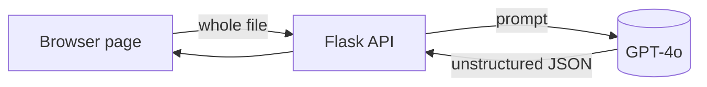
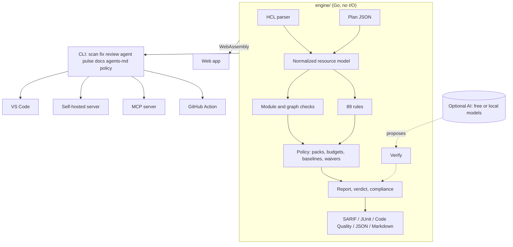

<p align="center"></p>

# TerraGuard

**Catch Terraform failures and security risks before `apply`.**

TerraGuard checks Terraform code and plans for misconfigurations, apply-time
errors and destructive changes. It explains every finding, fixes many of them
automatically, and enforces your organization's standards as code. One Go
engine runs in the browser, the editor, the terminal, CI, AI agents and your
own server. It is open source and costs nothing to run.

[](https://github.com/Karthik-099/TERRAGUARD/actions/workflows/ci.yml)
[](https://karthik-099.github.io/TERRAGUARD/)
[](go.mod)
[](LICENSE)

**[Open the web app](https://karthik-099.github.io/TERRAGUARD/)**: no install, no signup, your code stays in the browser.


---

## Contents

- [The problem](#the-problem)
- [What TerraGuard does](#what-terraguard-does)
- [Quick start](#quick-start)
- [Architecture: phase 1, phase 2, phase 3](#architecture-phase-1-phase-2-phase-3)
- [Policy-as-code](#policy-as-code)
- [How AI is used](#how-ai-is-used)
- [Integrations](#integrations)
- [Comparison with existing tools](#comparison-with-existing-tools)
- [Performance](#performance)
- [Documentation](#documentation)
- [Contributing](#contributing)

---

## The problem

Terraform runs in stages, and every stage has a failure mode that is usually
discovered too late:

| Stage | What goes wrong | How TerraGuard helps |
|---|---|---|
| **Write** | Public buckets, open security groups, wildcard IAM, hardcoded secrets, unpinned modules | Diagnostics on save, 89 rules with exact lines and fixes, verified AI fixes |
| **Init** | Unpinned providers; local, unencrypted or unlocked state; committed `*.tfstate` | Pinning, backend and state-file checks |
| **Validate** | `terraform validate` needs init and credentials, and misses provider-side errors | Syntax, reference and apply-time checks with no init |
| **Plan** | A destroy or replace of a database hides in a long plan | Plan risk with the attribute that forced replacement; rules on resolved values |
| **Review** | Legacy findings drown new ones; standards differ per reviewer; exceptions live in chat | Diff-aware review, policy-as-code, waivers with approver and expiry |
| **Apply** | Partial failures, data loss, no gate | Will-it-apply verdict, policy gate, GitOps pipeline with approval |
| **Operate** | Drift, audits, no view of who follows the standards | Pulse adoption reports, compliance mapping, opt-in drift detection |

## What TerraGuard does

| Capability | Details |
|---|---|
| **Will it apply?** | Syntax, duplicates, undeclared references, `count` + `for_each`, invalid CIDRs, S3 bucket names, port ranges, deprecated Lambda runtimes, missing tfvars. No `terraform init`. |
| **Security and correctness rules** | 89 rules across AWS, Google Cloud, Azure, Cloudflare, DigitalOcean, Hetzner, Akamai/Linode, OVHcloud/OpenStack, Oracle Cloud, Alibaba Cloud, Vultr, Kubernetes and Helm |
| **Attack paths** | Cross-resource graph checks, e.g. a public Lambda running as an admin role |
| **Plan risk** | Destroys and replaces of stateful resources, with the forcing attribute |
| **Auto-fix** | Syntax-tree edits that keep comments; `terraguard fix` |
| **Verified AI fixes** | `terraguard agent`: the AI proposes, the engine re-scans, and a change is kept only if it measurably reduces risk |
| **Diff-aware review** | `terraguard review`: only what a PR introduces or resolves, with a risk tier |
| **Policy-as-code** | Custom rules with `where` / `assert`, `extends` packs, risk budgets, baselines, expiring waivers, owners, policy tests, JSON Schema |
| **Pulse** | Control adoption, waiver inventory and trend across many modules |
| **Compliance** | Indicative mapping to CIS v8, SOC 2, PCI DSS 4.0, ISO 27001:2022, HIPAA |
| **Docs for humans and agents** | `terraguard docs` (README) and `terraguard agents-md` (AGENTS.md) |
| **Outputs** | Text, JSON, SARIF, JUnit, GitLab Code Quality, Markdown |

## Quick start

```bash
# Install (or use Docker below)
go install github.com/Karthik-099/TERRAGUARD/cmd/terraguard@latest

terraguard scan .                         # report; exit code 1 when the policy fails
terraguard scan . --plan plan.json        # add plan risk analysis
terraguard fix .                          # deterministic auto-fixes
terraguard agent . --write                # plus AI fixes, each verified by the engine
terraguard review --base origin/main .    # judge only what this branch introduces
terraguard pulse ./infra                  # adoption and waivers across many modules
terraguard docs . > README.md             # module documentation
terraguard agents-md . > AGENTS.md        # instructions for AI coding agents
terraguard policy test policies/tests     # unit-test your own policy

# Docker, no Go required
docker run --rm -v "$PWD:/src" -w /src ghcr.io/karthik-099/terraguard scan .
```

Exit codes: `0` passed, `1` the policy gate failed, `2` usage or runtime error.

## Architecture: phase 1, phase 2, phase 3

### Phase 1: AI-only MVP (April 2026)



It proved that developers want structured, severity-ranked findings with
fixes. But it could not be trusted as a gate:

- Each scan cost money and sent the code to a third party.
- Findings and line numbers changed between runs.
- It needed a server and an API key, and handled one file at a time.
- There were no plans, policies or fixes.

### Phase 2: deterministic engine (now)



- **One engine, many surfaces.** The browser, editor, CLI, CI, agents and server all produce the same result for the same input.
- **The engine decides.** The AI explains and proposes. `engine.Verify` accepts a change only if apply still works, no new medium-or-higher issue appears, and the risk weight goes down.
- **No backend to run.** The public site is static and the engine runs in the browser as WebAssembly.

### Phase 3: next

- Validate arguments against provider schemas (`terraform providers schema -json`).
- Module-aware analysis that follows local modules with their inputs.
- A language server so every editor gets diagnostics.
- SARIF inline fix suggestions.
- OPA/Rego import.
- Cost estimates for plan changes.

The full HLD and LLD are in [docs/ARCHITECTURE.md](docs/ARCHITECTURE.md). For a guided tour, read [docs/ACADEMY.md](docs/ACADEMY.md).

## Policy-as-code

```yaml
# .terraguard.yml
# yaml-language-server: $schema=https://raw.githubusercontent.com/Karthik-099/TERRAGUARD/main/schema/terraguard.schema.json
extends: [https://example.com/org-baseline.yml]   # inherit an organization baseline
fail_on: MEDIUM
max_findings: { HIGH: 0, MEDIUM: 10 }             # risk budget
severity_overrides: { "TG-AWS-RDS-*": CRITICAL }  # globs everywhere
disable: ["TG-CF-*"]

custom_rules:
  - id: ORG-PROD-001
    title: Production databases are multi-AZ with 14+ days of backups
    owner: data-platform
    docs_url: https://wiki.example.com/standards/databases
    resource_types: [aws_db_instance, aws_rds_cluster]
    where:  [{ attribute: tags.env, equals: prod }]
    assert:
      - { attribute: multi_az, equals: true }
      - { attribute: backup_retention_period, min: 14 }

waivers:
  - rule: ORG-EC2-001
    resource: aws_instance.legacy_batch
    reason: Pinned to m5 until the Q1 migration
    approved_by: payments-lead
    expires: "2027-03-31"        # expired waivers re-activate the finding
```

| Feature | Use it to |
|---|---|
| `extends` | Layer organization, platform and team policies (local paths or https) |
| `where` / `assert` | Scope a rule (e.g. production only) and require several conditions |
| Operators | `exists`, `equals`, `not_equals`, `in`, `not_in`, `matches`, `not_matches`, `contains`, `min`, `max` |
| `max_findings` | Gate on counts and tighten gradually |
| `scan --write-baseline` / `--baseline` | Adopt on an existing codebase: only new findings fail |
| `review --base` | Gate pull requests on what they introduce |
| Waivers | Exceptions with a reason, an approver and an expiry; inline `# terraguard:ignore` too |
| `owner`, `docs_url` | Route every finding to the team that owns the standard |
| `policy validate`, `policy test` | Check the policy and unit-test it with fixtures |
| JSON Schema | Autocomplete and validation in any editor |

A complete example lives in [examples/policies](examples/policies).

## How AI is used

AI is **optional**, and it never decides pass or fail.

| Used for | Not used for |
|---|---|
| Explaining a finding and its impact | Gating CI |
| Proposing fixes the rules cannot make (verified by the engine) | Judging its own fixes |
| Generating `terraform test` files and modules | Any change without your review |
| Summarizing a plan or a full-tier review | |

Measured on the demo project with a free Groq model: deterministic fixes took
the risk weight from **224 to 123**, and one verified AI fix took it to **24**.
A second AI proposal was **rejected** by the engine because it introduced a
new issue.

| Provider | Free key | Cost |
|---|---|---|
| Groq | https://console.groq.com/keys | Free tier |
| OpenRouter | https://openrouter.ai/keys | `:free` models |
| Google Gemini | https://aistudio.google.com/apikey | Free tier |
| Ollama, LM Studio, vLLM | https://ollama.com/download | Local; nothing leaves your machine |

Enterprises can bring any model: OpenAI, Anthropic, Azure OpenAI, AWS
Bedrock or Google Vertex through a gateway, or any OpenAI-compatible endpoint
with custom auth headers. Paid providers are used only when explicitly
chosen. TerraGuard falls back across models and providers automatically. Set
`TERRAGUARD_AI_LOCAL_ONLY=true`, or turn on Private mode in the web app, to
never call a public AI service.

## Integrations

| Where | How |
|---|---|
| Browser | [Web app](https://karthik-099.github.io/TERRAGUARD/) (WebAssembly, offline after load) |
| VS Code | `editors/vscode`: diagnostics on save, quick fixes. `.vsix` attached to each release |
| pre-commit | `.pre-commit-hooks.yaml`: hooks `terraguard` and `terraguard-fix` |
| GitHub Actions | `uses: Karthik-099/TERRAGUARD@main` with `command: scan`, `review` or `pulse` |
| GitLab CI | [templates/gitlab-ci.yml](templates/gitlab-ci.yml): Code Quality and JUnit in the merge request |
| Jenkins | [templates/Jenkinsfile](templates/Jenkinsfile) |
| Any CI | JSON, SARIF, JUnit or Markdown output; exit codes |
| AI agents | `terraguard mcp`: tools `scan_terraform`, `fix_terraform`, `generate_docs`, `generate_agents_md`, `list_rules` |
| Platform | `terraguard serve`: web app plus HTTP API (`/api/scan`, `/api/fix`, `/api/ai/chat`, `/api/stats`, `/metrics`), Docker image on GHCR |
| AWS, Azure, Google Cloud | [deploy/](deploy): private deployments (ECS Fargate, Container Apps, Cloud Run) and a Helm chart; CI templates for CodeBuild, Azure Pipelines and Cloud Build in [templates/](templates) |

The pipeline generator in the web app creates a full GitHub Actions workflow:
fmt, validate, OIDC plan, TerraGuard gate, approval and apply.

## Comparison with existing tools

| | TerraGuard | Checkov | Trivy (tfsec) | TFLint | `terraform validate` |
|---|---|---|---|---|---|
| Runs in the browser, no install | Yes | No | No | No | No |
| Security policy breadth | 89 rules | 1,000+ policies | Hundreds | Correctness focus | None |
| Apply-time validation | Common failures | No | No | Deep, provider rulesets | Syntax and references |
| Plan destroy and replace risk | Yes, with cause | Security only | Security only | No | No |
| Diff-aware PR gating | Yes | Baseline file | No | No | No |
| Auto-fix | Yes, plus verified AI fixes | Not in open source | No | Some rules | No |
| Waivers with approver and expiry | Yes | Skip comments | Expiry in comments | Ignore comments | No |
| Org adoption reporting | Pulse | Paid platform | No | No | No |

Mature scanners have broader libraries. TerraGuard focuses on the developer
workflow and works well alongside them. This comparison is based on public
documentation as of November 2026; corrections are welcome as an issue.

## Performance

| Measurement | Result |
|---|---|
| Full scan of a 12-resource module (native) | 1.3 ms |
| 200 files, 2,400 resources, 6,800 findings | 0.25 s, about 55 MB of memory |
| Network calls during a scan | 0 |
| Rule evals (45 labelled cases) | 100% recall, 100% precision |

Reproduce these with `go test -bench Scan ./engine` and `make evals`.

## Security and enterprise

- Code is analyzed where it lives: in the browser, on the runner, or in your network. No TerraGuard service ever receives it.
- The website enforces a strict Content-Security-Policy and Subresource Integrity. The server adds security headers, rate limits, an audit log and Prometheus metrics.
- The Docker image works fully air-gapped. Releases from v2.1 ship an SBOM, signed images and build provenance.

See [SECURITY.md](SECURITY.md) and [docs/SELF_HOSTING.md](docs/SELF_HOSTING.md).

## Documentation

- [docs/ACADEMY.md](docs/ACADEMY.md): how Terraform works, where it breaks, and how every TerraGuard feature works
- [docs/ARCHITECTURE.md](docs/ARCHITECTURE.md): HLD, LLD, pipelines and design decisions
- [docs/SELF_HOSTING.md](docs/SELF_HOSTING.md): Docker, private AI and secrets
- [CONTRIBUTING.md](CONTRIBUTING.md): add a rule in about 20 lines plus two test cases
- [GOVERNANCE.md](GOVERNANCE.md), [MAINTAINERS.md](MAINTAINERS.md), [ROADMAP.md](ROADMAP.md), [CHANGELOG.md](CHANGELOG.md), [ADOPTERS.md](ADOPTERS.md)

## Develop

```bash
make test         # vet and unit tests
make evals        # rule recall and precision gate
make policy-test  # example policy pack fixtures
make serve        # the full app at http://127.0.0.1:8080
make secrets      # fail if a credential is tracked
```

## Contributing

I am building TerraGuard in the open while learning how good infrastructure
tooling is designed, so I know parts of it can be done better. If you find it
useful, contributions of any size are welcome, and never expected: a star, an
issue, a review of the architecture, or a new rule. Advice from people with
more experience is as valuable as code. Start with
[CONTRIBUTING.md](CONTRIBUTING.md), open a
[rule request](https://github.com/Karthik-099/TERRAGUARD/issues/new?template=rule_request.yml),
or join the [discussions](https://github.com/Karthik-099/TERRAGUARD/discussions).

## License

[MIT](LICENSE) © Karthik
