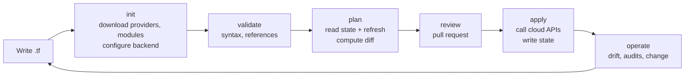
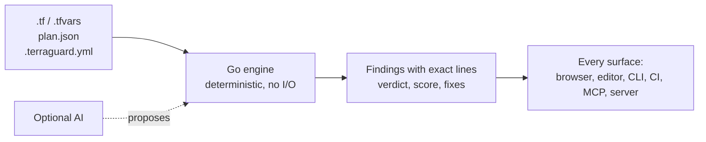
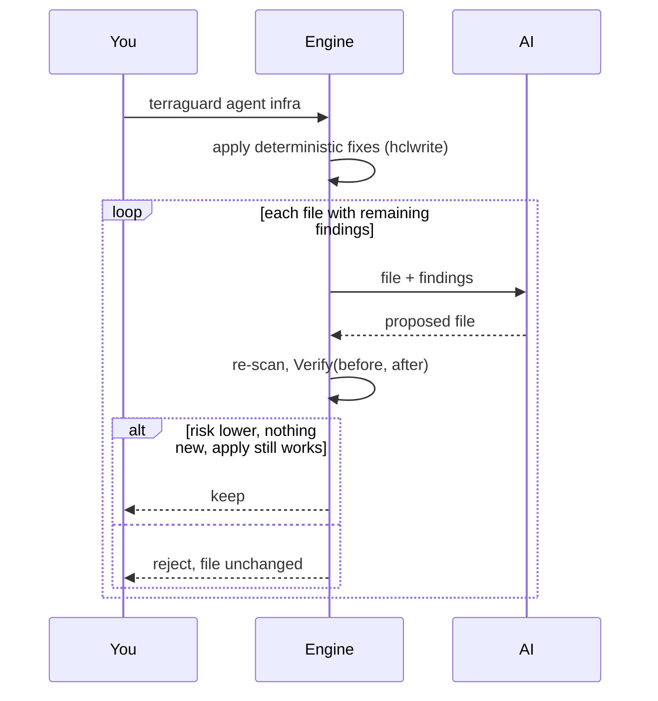

# TerraGuard Academy

A practical guide in three parts:

1. **How Terraform works**, for anyone new to infrastructure as code.
2. **Where Terraform breaks**, point by point at every stage.
3. **How TerraGuard works**, one feature at a time, with commands you can run on the examples in this repository.

Every lab runs on a laptop. You don't need a cloud account, credentials or a cluster.

---

## Part 1. How Terraform works

### 1.1 Concepts

| Concept | What it is | Example |
|---|---|---|
| **Provider** | A plugin that talks to one API (AWS, Cloudflare, Kubernetes) | `provider "aws" { region = "eu-west-1" }` |
| **Resource** | Something Terraform creates and manages | `resource "aws_s3_bucket" "logs" { ... }` |
| **Data source** | Something Terraform only reads | `data "aws_iam_policy_document" "x" { ... }` |
| **Variable / output** | Inputs and results of a module | `variable "region" {}`, `output "bucket_arn" {}` |
| **Module** | A reusable folder of Terraform | `module "vpc" { source = "terraform-aws-modules/vpc/aws" }` |
| **State** | Terraform's record of what exists, mapping code to real resource IDs | `terraform.tfstate`, usually in a remote backend |
| **Backend** | Where state is stored and locked | S3 with a lock, GCS, Azure Storage, HCP Terraform |
| **Plan** | The proposed diff between code, state and reality | `terraform plan -out tfplan` |

### 1.2 The lifecycle



1. **Write.** You describe the desired infrastructure in HCL.
2. **`terraform init`** downloads providers and modules and connects the backend.
3. **`terraform validate`** checks syntax and references. It needs `init` first.
4. **`terraform plan`** reads state, refreshes reality, and prints what will be created, changed, destroyed or replaced.
5. **Review.** A person, ideally a pipeline too, approves the change.
6. **`terraform apply`** calls the cloud APIs and records the result in state.
7. **Operate.** Reality drifts, audits ask for evidence, and the cycle repeats.

---

## Part 2. Where Terraform breaks

Each problem below is real, common and visible in the code before it causes
an incident. The TerraGuard rule that catches it is in brackets.

**Write**
- Storage made public by an ACL or a disabled public-access block [TG-AWS-S3-001, TG-AWS-S3-002, TG-GCP-GCS-001, TG-DO-SPACES-001, TG-OCI-OS-001]
- Admin ports open to `0.0.0.0/0` on any cloud [TG-AWS-SG-001, TG-GCP-FW-001, TG-AZ-NSG-001, TG-DO-FW-001, TG-HZ-FW-001, TG-OS-SG-001]
- Wildcard IAM and policies that allow any principal [TG-AWS-IAM-001, TG-AWS-IAM-002]
- Secrets written into code or tfvars [TG-SEC-001, TG-SEC-002]
- Privileged Kubernetes workloads and mutable images [TG-K8S-001, TG-K8S-002]
- Undocumented inputs and outputs [TG-TF-004]

**Init**
- Unpinned providers and modules, so builds change without a code change [TG-TF-001, TG-TF-002, TG-HELM-001]
- State that is local, unencrypted or unlocked; state committed to git [TG-STATE-001, TG-STATE-002, TG-STATE-003]

**Validate**
- `validate` needs init and often credentials, and misses provider-side errors such as invalid bucket names [TG-VAL-005], non-canonical CIDRs [TG-VAL-004], inverted ports [TG-VAL-006] and retired runtimes [TG-AWS-LAMBDA-002]

**Plan**
- A destroy or replace of a database hidden in a long plan [TG-PLAN-001, TG-PLAN-002]
- Values that only resolve at plan time are never security-checked

**Review**
- Legacy findings drown the ones a pull request introduces
- Every reviewer applies different standards; exceptions are agreed in chat

**Apply**
- Partial failures and data loss; nothing stops a risky change

**Operate**
- Drift, audit evidence, and no visibility into which teams follow the standards

---

## Part 3. How TerraGuard works

### 3.1 The mental model



- **Deterministic.** The same input always gives the same output, so the result can gate a merge.
- **One engine.** It is written once in Go and compiled to WebAssembly for the browser, so every surface agrees.
- **AI on the outside.** Models explain and propose. The engine verifies before anything is kept.

### 3.2 What happens during a scan

| Step | Code | What it does |
|---|---|---|
| Parse | `engine/parse.go` | HashiCorp's HCL parser reads each file. Literal values are evaluated; anything computed becomes `Unknown`. Syntax errors become findings. |
| Normalize | `engine/model.go` | Source resources and plan resources share one shape, so every rule checks both. |
| Resource rules | `engine/rules.go`, `rules_clouds.go` | 89 rules, each a small Go function returning hits with a line and an optional fix. |
| Module checks | `engine/checks.go` | Duplicates, undeclared references, tfvars, secrets, pinning, state, and the cross-resource graph (attack paths). |
| Plan | `engine/plan.go` | `terraform show -json` becomes a change summary plus destroy and replace risks. |
| Policy | `engine/policy.go` | `extends`, custom rules, overrides, disables, waivers with expiry, inline ignores, baselines. |
| Report | `engine/scan.go` | Score, grade, the will-it-apply verdict, gate reasons, compliance and the dependency graph. |
| Output | `engine/format.go` | Text, JSON, SARIF, JUnit, GitLab Code Quality, Markdown. |

Try it:

```bash
make build
bin/terraguard scan examples/insecure
bin/terraguard scan examples/secure --plan examples/plan.json
```

### 3.3 Will it apply?

A finding marked **blocking** means `terraform validate` or `apply` is
expected to fail. A waiver or baseline accepts a risk, but it does not make
apply succeed, so blocking findings always count toward the verdict.

```bash
bin/terraguard scan examples/insecure | tail -3
# terraform validate/apply is expected to FAIL: 3 blocking issue(s).
```

### 3.4 Fixing: deterministic first, AI second



```bash
bin/terraguard fix examples/insecure                 # deterministic only (writes files)
bin/terraguard agent examples/insecure               # dry run with AI (needs a free key or Ollama)
```

### 3.5 Diff-aware review

`terraguard review` scans the base revision and your working tree. It
reports only what the change **introduces** or **resolves**, assigns a risk
tier (trivial, lite, full), and fails only on new findings. Existing debt
never blocks a pull request.

```bash
bin/terraguard review --base origin/main .
```

### 3.6 Policy-as-code

```bash
bin/terraguard policy validate --config examples/policies/team-payments.yml
bin/terraguard policy test examples/policies/tests --config examples/policies/team-payments.yml
```

<a id="custom-policies"></a>
**Custom policies.** A rule selects resources by type (globs), filters them
with `where`, and requires every `assert` condition to hold. Conditions
support `exists`, `equals`, `not_equals`, `in`, `not_in`, `matches`,
`not_matches`, `contains`, `min` and `max`. Values computed at plan time are
skipped, so static checks never guess.

**Rolling out on an existing codebase:**

1. `terraguard scan . --write-baseline .terraguard-baseline.json`, then commit the file.
2. Run `terraguard scan . --baseline .terraguard-baseline.json` in CI. Only new findings fail.
3. Add `max_findings` budgets and lower them each quarter.
4. Track progress with `terraguard pulse`.

### 3.7 Pulse: adoption across an organization

```bash
bin/terraguard pulse examples --json pulse.json
bin/terraguard pulse examples --baseline pulse.json     # shows the trend
```

Pulse reports, for every module:

- which controls it meets: policy file, gate, apply-safe, pinned versions, locked state, no secrets;
- the most common issues;
- every waiver, sorted by expired, expiring, missing expiry, and active.

### 3.8 Context for people and agents

```bash
bin/terraguard docs examples/secure        # README: inputs, outputs, providers, resources
bin/terraguard agents-md examples/insecure # AGENTS.md: commands, guardrails, boundaries, waivers
```

AGENTS.md tells coding agents how this repository works, which standards
apply, and what they must not touch: stateful resources, waived risks, and
`terraform apply`.

### 3.9 AI routing and privacy

```bash
bin/terraguard ai     # prints the fallback route built from .env
```

- The route uses free tiers first (Groq, OpenRouter `:free`, Gemini), then a local model.
- A rate-limited or retired model falls through to the next one.
- `TERRAGUARD_AI_LOCAL_ONLY=true` removes every hosted provider.
- Keys never appear in logs, responses or errors (`internal/ai.Redact`).

### 3.10 Surfaces

| Surface | Start it | Best for |
|---|---|---|
| Web app | Open the site, or `make serve` | Trying it, sharing a link, demos |
| VS Code | `editors/vscode` (`.vsix` in releases) | Feedback while typing |
| pre-commit | `.pre-commit-hooks.yaml` | Stopping risky commits |
| GitHub Action | `command: scan`, `review` or `pulse` | PR gates, code scanning, adoption reports |
| GitLab, Jenkins | `templates/` | Merge request widgets, test reports |
| MCP | `terraguard mcp` | Claude Code, Cursor and other agents |
| Server | `terraguard serve` or Docker | A private team instance with shared keys |

---

## Labs

1. **Find and fix.** Run `bin/terraguard scan examples/insecure`, then `bin/terraguard fix` on a copy of it. How many findings remain, and why can't they be auto-fixed?
2. **Plan risk.** Run `bin/terraguard scan examples/secure --plan examples/plan.json`. Which change would lose data, and which attribute forced it?
3. **Write a rule.** Add a custom rule requiring `tags.cost_center` to match `^CC-[0-9]{4}$`. Write one fixture that must fail and one that must pass, then run `policy test`.
4. **Adopt gradually.** Write a baseline for `examples/insecure`, add a new open security group, and confirm that only the new finding fails the gate.
5. **Review a change.** In a git repository, change a `.tf` file and run `bin/terraguard review --base HEAD .`.
6. **Measure adoption.** Run `pulse` on `examples/`, add a `.terraguard.yml` to `examples/secure`, and compare the trend.
7. **Private AI.** Install Ollama, set `TERRAGUARD_OLLAMA_URL` and `TERRAGUARD_AI_LOCAL_ONLY=true`, and run `terraguard agent`.

## Glossary

| Term | Meaning |
|---|---|
| Blocking finding | Terraform validate or apply is expected to fail |
| Gate | The pass or fail decision used by CI |
| Risk weight | Sum of active findings weighted by severity (critical 20, high 8, medium 3, low 1) |
| Waiver | An accepted risk with a reason, an approver and an expiry |
| Baseline | Findings accepted as existing debt so that only new ones fail |
| Policy pack | A shared `.terraguard.yml` that others `extends` |
| Verify | The engine's check that an AI proposal is a real improvement |
