# TerraGuard Architecture

This doc covers the high-level design (HLD), the low-level design (LLD), every
application and pipeline, and the reasoning behind each decision. The diagrams
are Mermaid and render on GitHub.

1. [Goals and constraints](#1-goals-and-constraints)
2. [System overview (HLD)](#2-system-overview-hld)
3. [Applications](#3-applications)
4. [Engine internals (LLD)](#4-engine-internals-lld)
5. [Cloud coverage](#5-cloud-coverage)
6. [AI: optional, advisory, with fallback routing](#6-ai-optional-advisory-with-fallback-routing)
7. [Pipelines](#7-pipelines)
8. [Live stats dashboard](#8-live-stats-dashboard)
9. [Policy-as-code, waivers and compliance](#9-policy-as-code-waivers-and-compliance)
10. [Security, privacy and secrets](#10-security-privacy-and-secrets)
11. [Quality: tests and evals](#11-quality-tests-and-evals)
12. [Repository layout](#12-repository-layout)
13. [Design decisions](#13-design-decisions)
14. [Roadmap](#14-roadmap)

---

## 1. Goals and constraints

**Problems Terraform engineers hit every week**

| Pain | What TerraGuard does |
|---|---|
| `plan` succeeds but `apply` fails (bad bucket name, non-canonical CIDR, inverted ports, deprecated Lambda runtime) | "Will it apply?" checks that know provider-side validation |
| `terraform validate` needs `init`, provider downloads and credentials just to catch a typo | Validates syntax, duplicates and references with no init, in milliseconds |
| Security review is late, manual and inconsistent across AWS, GCP, Azure, Cloudflare, DigitalOcean, Hetzner, OVH, Oracle, Kubernetes… | Rules across 14 providers with exact lines, CWE IDs and fixes, gated in CI |
| Each resource looks fine alone, but together they form an attack path | Graph checks over the reference graph |
| A plan quietly replaces the production database | Plan analysis: destroy/replace of stateful resources, with the attribute that forced it |
| State is local, unencrypted, unlocked, or committed to git | State backend checks (encrypt, locking) and committed `*.tfstate` detection |
| Subdomain takeover from stale CNAMEs; DNSSEC off | DNS/CDN rules |
| Surprise cloud bills (gp2, previous-gen instances, infinite log retention) | Cost rules with auto-fixes |
| Fixing findings is tedious | One-click auto-fix that keeps comments and formatting |
| Exceptions live in Slack threads; auditors ask for evidence | Waivers in git with a reason, an approver and an expiry; compliance mapping |
| Module READMEs drift from the code | terraform-docs style docs generator |

**Constraints**

- **No servers to pay for.** The public site is static (GitHub Pages). The optional public counters run on Cloudflare's free tier.
- **Never upload user code.** Analysis runs locally in the browser, on the laptop, in the user's CI, or on the user's own server.
- **The LLM is optional and advisory.** Every gating decision is deterministic.
- **CI cost.** Workflows run only when relevant files change. There are no schedules.

**Cost: $0.** Every component runs on a free tier or on your own machine.

| Component | Cost | Notes |
|---|---|---|
| Engine, CLI, MCP, self-hosted server | $0 | Open source; runs on your machine |
| GitHub Pages, Actions, code scanning (SARIF) | $0 | Free for public repositories |
| AI: Groq, OpenRouter `:free` models, Gemini | $0 | Free tiers; paid APIs are deliberately not in the route |
| AI: Ollama / LM Studio | $0 | Runs locally |
| Live stats counters (optional) | $0 | Cloudflare Workers free plan, no card. Skip it and the site still works fully |

---

## 2. System overview (HLD)

One Go engine is built into five applications, so the same rules run everywhere.

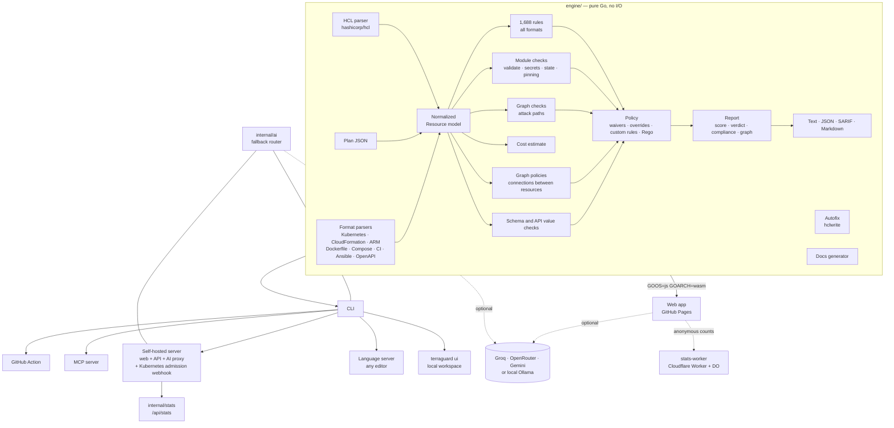

---

## 3. Applications

| # | Application | Who uses it | Entry point | Runs on |
|---|---|---|---|---|
| 1 | **Web app** | Anyone: paste, drop a folder, edit, fix, share | `web/` + `cmd/wasm` | Visitor's browser (GitHub Pages / Cloudflare Pages / any static host) |
| 2 | **CLI** | Engineers, pre-commit hooks | `cmd/terraguard` | Laptop, any CI |
| 3 | **GitHub Action** | Teams: PR gate, GitOps | `action.yml` | User's GitHub runner |
| 4 | **MCP server** | AI coding agents (Claude Code, Cursor, …) | `terraguard mcp` | Developer machine (stdio) |
| 5 | **Self-hosted server** | Teams wanting one private URL and shared keys | `terraguard serve` / Docker | User's server or laptop |
| 6 | **VS Code extension** | Engineers while typing | `editors/vscode` | Developer machine (calls the CLI) |
| 7 | **CI templates** | GitLab CI, Jenkins | `templates/` | User's runners (Docker image) |
| - | **Stats worker** | Public dashboard counters (optional) | `stats-worker/` | Cloudflare (free plan) |

### 3.1 Web app

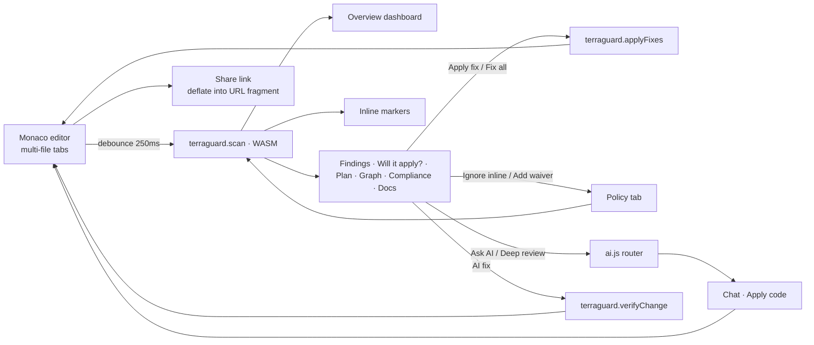

The site has two views. The **product page** explains the Terraform lifecycle, the architecture, AI usage, policy, comparisons, integrations and open-source contribution. The **workspace** (`#/app`) loads the engine and editor lazily and has these tabs: Overview (score, will-it-apply checks, gate reasons, top risks, compliance), Findings, Plan, Graph, Compliance, Policy, Docs (README or AGENTS.md), Assistant, Pipeline generator and Rules.

### 3.2 CLI

| Command | Purpose |
|---|---|
| `scan [paths] [--plan] [--format text,json,sarif,junit,codequality,markdown] [--baseline] [--write-baseline]` | Full analysis and policy gate |
| `review --base REV [paths]` | Diff-aware review: new and resolved findings, risk tier, gate on new only |
| `fix [paths]` | Deterministic auto-fixes |
| `agent [paths] [--write]` | Deterministic fixes, then AI proposals verified by `engine.Verify` |
| `pulse [roots] [--baseline] [--json]` | Control adoption, waivers and trend across modules |
| `policy validate`, `policy test DIR` | Check a policy (with `extends`) and run fixture tests |
| `docs`, `agents-md` | README and AGENTS.md generation |
| `ask`, `ai` | Advisory AI questions; show the fallback route |
| `serve`, `mcp`, `rules` | Self-hosted server, MCP server, rule catalog |

It reads `.env` automatically (keys are case-insensitive) and exits 0 when the policy passes, 1 when it fails, and 2 on error.

### 3.3 Review, agent and pulse

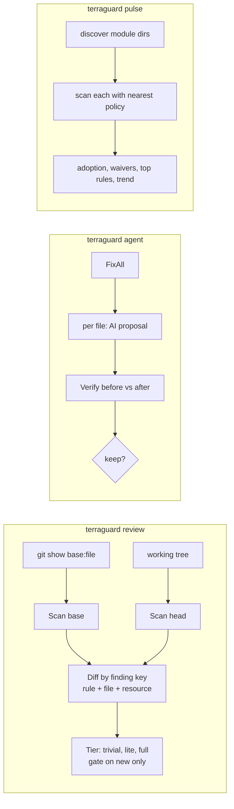

Finding keys deliberately exclude line numbers, so unrelated edits above a
finding don't make it look new.

### 3.4 Self-hosted server

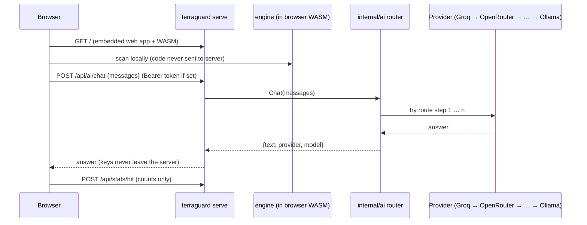

---

## 4. Engine internals (LLD)

### 4.1 Data model

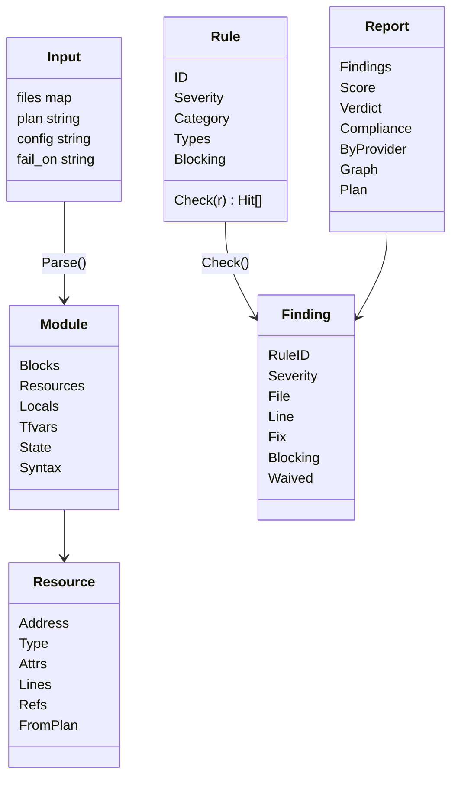

**Key idea: one normalized `Resource`.** HCL attributes are evaluated into plain
values. Nested blocks become lists, and non-literal expressions become
`Unknown{Expr}`. Plan JSON `after` values have the same shape, so each rule is
written once and runs on both source code and resolved plan values.

### 4.2 Scan pipeline

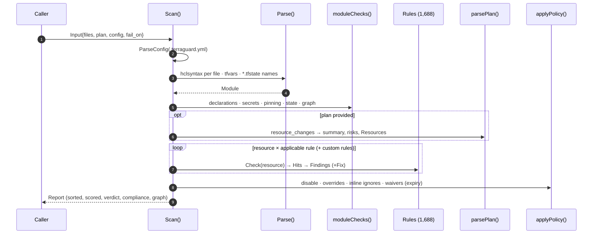

### 4.3 One model for every format

Every format is read into the same `Resource` (type, address, file, line,
attributes, a line for every attribute path). A format registers a parser in
`engine/formats.go`; detection uses the file name and the first bytes, so
unrelated YAML and JSON are skipped. Kubernetes objects are converted to the
shape of the Terraform kubernetes provider, so one rule set covers manifests,
Helm and Kustomize output and Terraform alike. CloudFormation keeps its own
types (`AWS::S3::Bucket`) and ARM its own (`Microsoft.Storage/storageAccounts`),
with their parameter and expression languages resolved where the value is a
literal; anything unresolved becomes `Unknown`, which no rule fires on. Rules,
policy, waivers, ignores, outputs and the gate are the same for every format;
only auto-fix is limited to Terraform, where `hclwrite` can edit safely.

Rules come from four places, all compiled into one list: hand-written Go
rules; single-setting table checks; tables generated by `tools/ckvgen` from
reviewed reference data (with our own wording, overrides and duplicate
mappings in `tools/ckvgen/*.txt`); and graph policies evaluated over the
reference graph (`graphpolicy.go`). Parity tests run each rule against the
reference fixtures for the same control, and a corpus of public modules guards
against false "will not apply" verdicts.

### 4.4 Parsing details

| Concern | How it's handled |
|---|---|
| Parser | `hashicorp/hcl/v2/hclsyntax`, Terraform's own parser, so line numbers are exact |
| Expressions | Evaluated with every referenced root set to `cty.DynamicVal`, so a list can be partly known |
| `jsonencode({...})` | The argument object is kept as structure, so IAM statements stay inspectable even with ARN references |
| References | Scope-aware for `for` expressions. `dynamic` iterators are excluded. `provider`/`lifecycle` are skipped |
| Errors | Syntax errors are blocking findings per file. Other files are still analyzed |

### 4.5 Scoring, verdict and gate

- **Score** starts at 100 and subtracts per active finding: Critical 20, High 8, Medium 3, Low 1. Grades: A ≥ 90, B ≥ 75, C ≥ 60, D ≥ 40, F below.
- **Verdict ("will it apply?")** is false if any active finding is `Blocking`.
- **Gate** fails on any blocking finding, or on any active finding at or above `fail_on`.

### 4.6 Autofix

Fixes target a block address and an attribute path (for example
`resource.aws_db_instance.main` + `storage_encrypted`), not line numbers. They
are applied with `hclwrite`, which creates missing nested blocks and keeps
comments. Fixes that force replacement say so.

---

## 5. Cloud coverage

| Provider | Examples of what's checked |
|---|---|
| **AWS** | S3 ACL/BPA/versioning, SG exposure, RDS public/unencrypted/backups, IAM wildcards & `Principal "*"`, AdministratorAccess, KMS rotation, CloudTrail, EBS, IMDSv2, EKS endpoint, Lambda URL auth, **deprecated Lambda runtimes**, ALB/CloudFront TLS, SQS/SNS, ECR, ElastiCache/OpenSearch, VPC flow logs, Route 53 DNSSEC |
| **Google Cloud** | GCS public/UBLA, firewall exposure, Cloud SQL authorized networks & SSL, primitive/public IAM, GKE ABAC & master networks, default SA scopes, Cloud DNS DNSSEC |
| **Azure** | Storage TLS/public, NSG exposure, Key Vault purge protection, SQL/Postgres/MySQL firewall, AKS public API/RBAC, CDN/Front Door HTTP |
| **Cloudflare** | SSL mode, min TLS, HTTPS redirect, security level, DNS-only records, Worker plain-text secrets, zone DNSSEC |
| **DigitalOcean** | Firewall exposure, public Spaces, databases without trusted sources, droplets without SSH keys |
| **Hetzner** | Firewall exposure, servers with no firewall |
| **Akamai/Linode** | `inbound_policy = ACCEPT`, open inbound rules |
| **OVHcloud / OpenStack** | Security group rules open to the internet, managed DB IP restrictions |
| **Oracle Cloud** | Security lists / NSG rules, public buckets |
| **Alibaba Cloud** | Security group rules, public OSS |
| **Vultr** | Firewall rules |
| **Kubernetes / Helm** | Privileged / host-namespace pods, mutable images, open LoadBalancers, plain-text secrets, unpinned charts |
| **Any provider** | Syntax/references/duplicates, CIDRs, hardcoded secrets & key patterns, provider/module pinning, `required_version`, state backend, committed state, subdomain-takeover CNAMEs, cost |

Run `terraguard rules` for the full catalog of 1,688 rules.

---

## 6. AI: optional, advisory, with fallback routing

**Is an LLM needed? No.** It only produces responses and suggestions:
explaining findings, remediation plans, file rewrites, generating modules and
`terraform test` files, cost review, provider-upgrade help, plan explanations,
and a "deep review" whose results are labelled **AI suggestion**. It never
decides pass/fail.

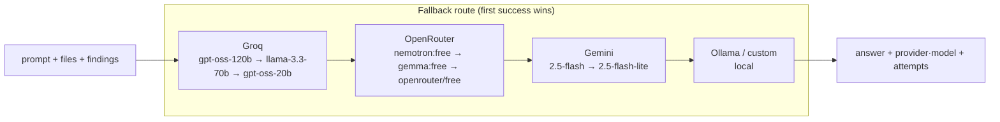

| Concern | Behaviour |
|---|---|
| Rate limit / outage / timeout / retired model | Next model, then next provider |
| Bad key (401/403) | Skip the rest of that provider |
| `TERRAGUARD_AI_LOCAL_ONLY=true` / browser **Private mode** | Hosted providers removed from the route |
| `TERRAGUARD_AI_ROUTE` | Explicit chain, e.g. `groq:openai/gpt-oss-120b,openrouter,ollama` |
| Errors | Key-shaped strings redacted before logging or display |

| Provider | Free key |
|---|---|
| Groq | https://console.groq.com/keys |
| OpenRouter | https://openrouter.ai/keys |
| Google Gemini | https://aistudio.google.com/apikey |
| Ollama (local) | https://ollama.com/download |

`evals/llmeval` benchmarks any provider against the same labelled cases
as the engine, which is the evidence for keeping the LLM out of the gate.

---

## 7. Pipelines

### 7.1 Pipelines in *your* Terraform repo (generated by the Pipeline tab)

The GitHub Action has three modes:

| `command` | Use it for | Gate |
|---|---|---|
| `scan` (default) | Main branch, scheduled audits, plan analysis | All active findings |
| `review` | Pull requests on repositories with existing debt (needs `fetch-depth: 0`) | Only findings the PR introduces |
| `pulse` | Platform repositories with many modules | No gate; report in the job summary, JSON as the next baseline |

GitLab CI and Jenkins use the Docker image through `templates/`. GitLab shows
findings in the merge request widget through the Code Quality report.

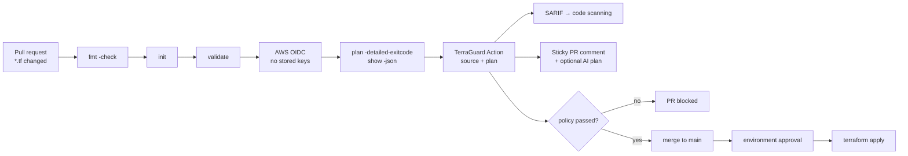

- **Triggers:** PRs and pushes touching `**/*.tf`, `**/*.tfvars` or `.terraguard.yml`. Pipelines in your other projects are never triggered.
- **Opt-in only:** drift detection (scheduled) and apply-on-merge.
- **Concurrency:** a running apply is never cancelled.

### 7.2 Pipelines in *this* repo: path-filtered, no cron

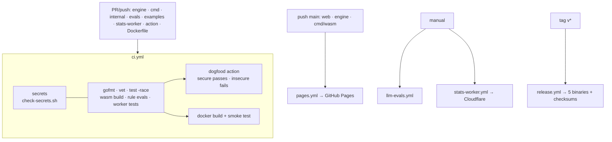

| Workflow | Runs when | Approx. time |
|---|---|---|
| `ci.yml` | Go / evals / worker / action / Dockerfile changes | 2–4 min |
| `pages.yml` | Site or engine changes on `main` | ~1 min |
| `llm-evals.yml` | Manual | ~2 min (your free key) |
| `stats-worker.yml` | Manual | ~1 min |
| `release.yml` | `v*` tag | ~1 min |

---

## 8. Live stats dashboard

Public, anonymous counters show how much Terraform is being evaluated:
evaluations, **Terraform files checked**, resources analyzed, issues found,
auto-fixes and AI answers, for today, the last 7 days and all time. The
dashboard also shows how many people are active right now, what's executing
on the server, where scans ran, and the most common issues.

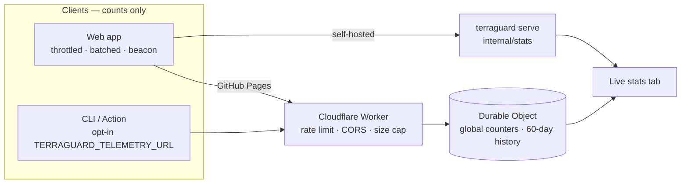

| Counted | Never counted |
|---|---|
| Number of evaluations, files, resources, findings, fixes, AI answers; rule IDs; surface; a random per-tab session ID for "active now" | Code, file names, resource names, IP addresses (rate-limit buckets live only in memory), keys |

Not counted when: Do-Not-Track or Global Privacy Control is on, Private mode is on, or the user unticks the setting. CLI and Action are counted only when opted in.

---

## 9. Policy-as-code, waivers and compliance

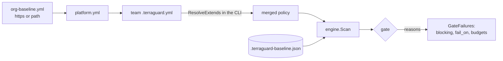

| Layer | Behaviour |
|---|---|
| `extends` | Base packs are merged first; scalars and same-ID rules are replaced; lists are appended; cycles and depth over 8 are rejected. The engine stays I/O-free: the CLI loads files or https and hands over one merged document. |
| Custom rules | `resource_types` globs, then every `where` condition must hold, then the inline condition and every `assert` must hold. Values computed at plan time are skipped. |
| Operators | `exists`, `equals`, `not_equals`, `in`, `not_in`, `matches`, `not_matches`, `contains`, `min`, `max` |
| Overrides and disables | Rule IDs or globs (`TG-CF-*`) |
| Waivers | Rule glob, resource glob, reason, approver, expiry. Expired waivers re-activate the finding and raise TG-POL-001 |
| Baselines | `scan --write-baseline` stores finding keys; `--baseline` reports them as waived |
| Budgets | `max_findings` fails the gate when a severity exceeds its count |
| Verdict vs gate | A waiver or baseline accepts a risk but does not make apply succeed: blocking findings always count toward "will it apply" |
| Ownership | `owner` and `docs_url` are copied onto every finding |
| Testing | `terraguard policy test DIR` runs `# expect:` / `# forbid:` fixtures; `schema/terraguard.schema.json` validates the file in editors |

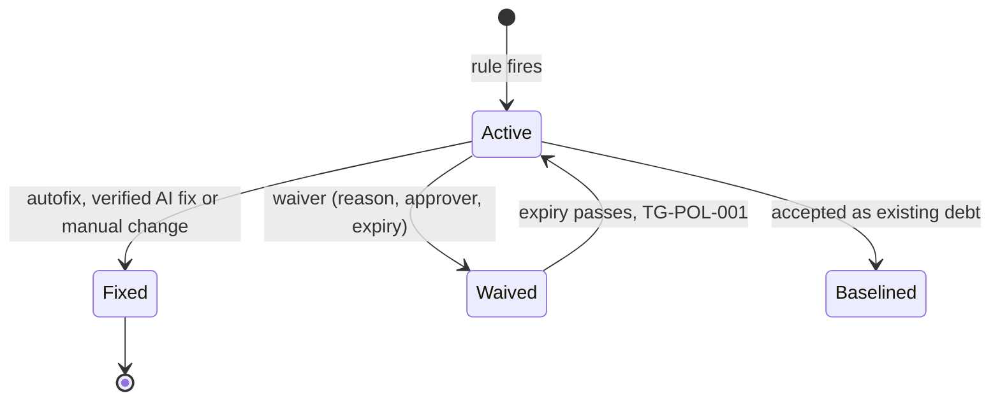

**Compliance mapping (indicative).** Each rule maps to control themes
(encryption at rest/in transit, network exposure, access control, secrets,
logging, backup, change/supply-chain). The themes map to **CIS Controls v8,
SOC 2, PCI DSS v4.0, ISO/IEC 27001:2022 and HIPAA**. A control "fails" when
an active finding is evidence against it. This helps prepare for audits; it
is not a certification.

---

## 10. Security, privacy and secrets

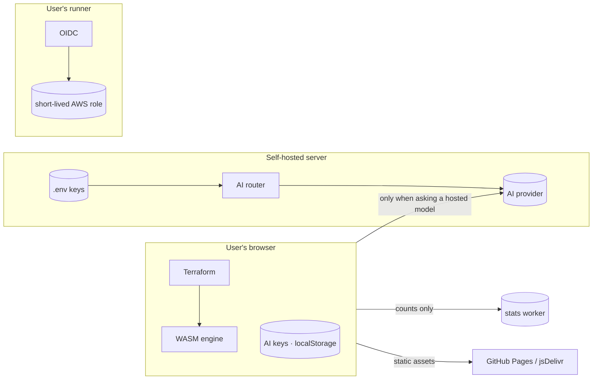

- No TerraGuard-operated backend sees code. The only optional shared service stores counts.
- **Keys:** stored only in `.env`, CI secrets or browser `localStorage`, and sent only to their provider. `/api/config` returns provider and model names only. Errors pass through `Redact()`. `.dockerignore` excludes `.env`.
- **Repository:** `scripts/check-secrets.sh` runs in CI and as a pre-commit hook, and fails on any tracked key or `.env`.
- **Server:** binds to `127.0.0.1` by default and warns when exposed without `TERRAGUARD_SERVER_TOKEN`. The token is compared in constant time, request bodies are capped at 5 MB, and the Docker image is distroless, non-root and read-only.
- **LLM output** is sanitized with DOMPurify, and AI code is applied only on click.
- An invalid `.terraguard.yml` makes the CLI exit 2 instead of silently using defaults.

Full self-hosting and privacy guide: [SELF_HOSTING.md](SELF_HOSTING.md).

---

## 11. Quality: tests and evals

| Layer | Command | What it proves |
|---|---|---|
| Engine unit tests | `make test` | Examples, the clean secure project, autofix round-trip, plan, ignores, scoping, custom rules (where, assert, operators, globs), extends merging and cycles, baselines, budgets, Verify, review diffing, AGENTS.md, SARIF, JUnit, Code Quality |
| CLI tests | `make test` | Agent keeps a verified fix and rejects a worse one (fake model server); review against a real git repository |
| Pulse tests | `make test` | Adoption counts, waiver states (expired, expiring, no expiry, active), trend deltas |
| Policy fixtures | `make policy-test` | The example policy pack behaves as documented |
| VS Code tests | `cd editors/vscode && npm test` | Report-to-diagnostic mapping against real CLI output |
| AI router tests | `make test` | `.env` parsing, route order and overrides, fallback on 429, skip on 401, local-only, key redaction |
| Server tests | `make test` | `/api/config` never exposes keys, stats never contain code, token auth |
| Rule evals | `make evals` | 45 labelled cases (`# expect:` / `# forbid:`). CI fails on any miss or false positive |
| Worker tests | `make worker-test` | Clamping, history pruning, never storing code |
| LLM benchmark | `go run ./evals/llmeval --provider groq` | Recall and precision of an LLM-only reviewer on the same cases |
| Dogfood | `ci.yml` | The action passes the secure example, fails the insecure one, and runs pulse; the Docker image scans and serves the app |

---

## 12. Repository layout

| Path | Contents |
|---|---|
| `engine/` | Parser, rules (`rules.go`, `rules_clouds.go`), module/graph checks, plan, policy, compliance, docs, autofix, formats |
| `internal/ai/` | Provider router, fallback, `.env` loader, redaction |
| `internal/stats/` | Anonymous counters for `terraguard serve` |
| `cmd/terraguard/` | CLI, MCP server, self-hosted server |
| `cmd/wasm/` | Browser bridge |
| `web/` | Static app (also embedded into the server binary) |
| `stats-worker/` | Cloudflare Worker + Durable Object for public counters |
| `action.yml` | Composite GitHub Action |
| `evals/` | Labelled cases (run by `make evals`) and `evals/llmeval`, the Go LLM benchmark |
| `deploy/` | Private deployments: AWS ECS Fargate, Azure Container Apps, Google Cloud Run (Terraform) and a Helm chart |
| `templates/` | CI templates: GitLab, Jenkins, AWS CodeBuild, Azure Pipelines, Google Cloud Build |
| `editors/vscode/` | VS Code extension |
| `schema/` | JSON Schema for `.terraguard.yml` |
| `examples/` | Insecure, multi-cloud and secure projects; sample plan |
| `scripts/` | `check-secrets.sh` |
| `Dockerfile`, `docker-compose.yml` | Self-hosting (optional bundled Ollama) |

---

## 13. Design decisions

| Decision | Alternatives | Why |
|---|---|---|
| Go engine → WASM + CLI + server | Python backend (previous Flask design), JS rewrite | Terraform's own parser, one codebase for five surfaces, no server needed |
| Deterministic gate, LLM advisory | LLM-only analysis (previous design) | Reproducible, free, offline, measurable; LLM answers vary and can hallucinate (see `evals/llmeval`) |
| Normalized `Resource` model | Separate rules for source and plan | Each rule written once, covering code and resolved plan values |
| Multi-model, multi-provider fallback | Single provider | Free tiers rate-limit and retire models monthly; the user still gets an answer |
| BYOK in the browser, `.env` on the server | Shared hosted key | No key to leak or rate-limit, users control spend, private mode is possible |
| Cloudflare Worker + Durable Object for counters | No stats, or a database server | Free, serverless, strongly consistent single counter, no PII |
| Path-filtered workflows, no cron | Scheduled scans | Saves CI minutes and doesn't trigger other pipelines |
| `hclwrite` autofix | Regex | Edits the syntax tree, so comments survive and nested blocks are created correctly |

---

## 14. Roadmap

Contributions are welcome. See [CONTRIBUTING.md](../CONTRIBUTING.md).

- `.tf.json` input and module-aware analysis (follow `./modules/x` with their inputs).
- SARIF `fixes` so GitHub suggests the auto-fix inline.
- Cost estimates from public pricing for plan changes.
- More providers: Scaleway, Exoscale, IBM Cloud, Fastly, Datadog.
- VS Code extension using the same WASM engine.
- OPA/Rego import for existing policy libraries.
