# TerraGuard Architecture

This doc covers the high-level design (HLD), the low-level design (LLD), every
application and pipeline, and the reasoning behind each decision. The diagrams
are Mermaid and render on GitHub.

1. [Goals and constraints](#1-goals-and-constraints)
2. [System overview (HLD)](#2-system-overview-hld)
3. [Applications](#3-applications)
4. [Engine internals (LLD)](#4-engine-internals-lld)
5. [Cloud coverage](#5-cloud-coverage)
6. [AI: optional, advisory, with fallback routing](#6-ai-optional-advisory-with-fallback-routing)
7. [Pipelines](#7-pipelines)
8. [Live stats dashboard](#8-live-stats-dashboard)
9. [Policy-as-code, waivers and compliance](#9-policy-as-code-waivers-and-compliance)
10. [Security, privacy and secrets](#10-security-privacy-and-secrets)
11. [Quality: tests and evals](#11-quality-tests-and-evals)
12. [Repository layout](#12-repository-layout)
13. [Design decisions](#13-design-decisions)
14. [Roadmap](#14-roadmap)

---

## 1. Goals and constraints

**Problems Terraform engineers hit every week**

| Pain | What TerraGuard does |
|---|---|
| `plan` succeeds but `apply` fails (bad bucket name, non-canonical CIDR, inverted ports, deprecated Lambda runtime) | "Will it apply?" checks that know provider-side validation |
| `terraform validate` needs `init`, provider downloads and credentials just to catch a typo | Validates syntax, duplicates and references with no init, in milliseconds |
| Security review is late, manual and inconsistent across AWS, GCP, Azure, Cloudflare, DigitalOcean, Hetzner, OVH, Oracle, Kubernetes… | Rules across 14 providers with exact lines, CWE IDs and fixes, gated in CI |
| Each resource looks fine alone, but together they form an attack path | Graph checks over the reference graph |
| A plan quietly replaces the production database | Plan analysis: destroy/replace of stateful resources, with the attribute that forced it |
| State is local, unencrypted, unlocked, or committed to git | State backend checks (encrypt, locking) and committed `*.tfstate` detection |
| Subdomain takeover from stale CNAMEs; DNSSEC off | DNS/CDN rules |
| Surprise cloud bills (gp2, previous-gen instances, infinite log retention) | Cost rules with auto-fixes |
| Fixing findings is tedious | One-click auto-fix that keeps comments and formatting |
| Exceptions live in Slack threads; auditors ask for evidence | Waivers in git with a reason, an approver and an expiry; compliance mapping |
| Module READMEs drift from the code | terraform-docs style docs generator |

**Constraints**

- **No servers to pay for.** The public site is static (GitHub Pages). The optional public counters run on Cloudflare's free tier.
- **Never upload user code.** Analysis runs locally in the browser, on the laptop, in the user's CI, or on the user's own server.
- **The LLM is optional and advisory.** Every gating decision is deterministic.
- **CI cost.** Workflows run only when relevant files change. There are no schedules.

**Cost: $0.** Every component runs on a free tier or on your own machine.

| Component | Cost | Notes |
|---|---|---|
| Engine, CLI, MCP, self-hosted server | $0 | Open source; runs on your machine |
| GitHub Pages, Actions, code scanning (SARIF) | $0 | Free for public repositories |
| AI: Groq, OpenRouter `:free` models, Gemini | $0 | Free tiers; paid APIs are deliberately not in the route |
| AI: Ollama / LM Studio | $0 | Runs locally |
| Live stats counters (optional) | $0 | Cloudflare Workers free plan, no card. Skip it and the site still works fully |

---

## 2. System overview (HLD)

One Go engine is built into five applications, so the same rules run everywhere.

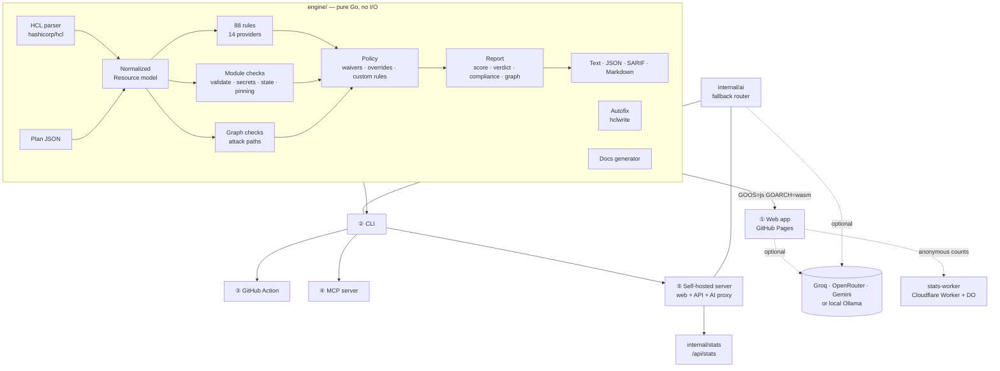

---

## 3. Applications

| # | Application | Who uses it | Entry point | Runs on |
|---|---|---|---|---|
| ① | **Web app** | Anyone: paste, drop a folder, edit, fix, share | `web/` + `cmd/wasm` | Visitor's browser (GitHub Pages / Cloudflare Pages / any static host) |
| ② | **CLI** | Engineers, pre-commit hooks | `cmd/terraguard` | Laptop, any CI |
| ③ | **GitHub Action** | Teams: PR gate, GitOps | `action.yml` | User's GitHub runner |
| ④ | **MCP server** | AI coding agents (Claude Code, Cursor, …) | `terraguard mcp` | Developer machine (stdio) |
| ⑤ | **Self-hosted server** | Teams wanting one private URL and shared keys | `terraguard serve` / Docker | User's server or laptop |
| — | **Stats worker** | Public dashboard counters | `stats-worker/` | Cloudflare (free plan) |

### ① Web app

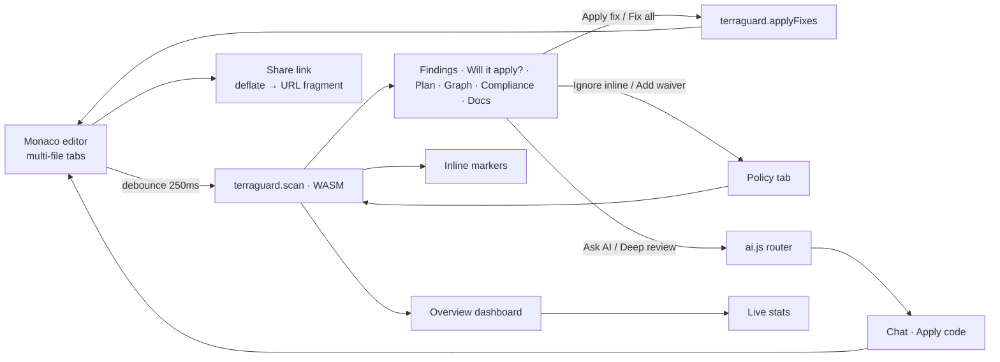

Tabs: Overview (score ring, severity, categories, clouds, top risks, compliance), Findings (severity and cloud filters, fix / ignore / waive / false-positive), Will it apply?, Plan, Graph (attack paths in red), Compliance, AI assistant, Policy, Docs, CI/CD generator, Live stats, Rules, Community (GitHub stats and giscus comments). Light and dark themes are available.

### ② CLI

```text
terraguard scan [paths] [--plan plan.json] [--format text|json|sarif|markdown] [--fail-on SEV] [--ai]
terraguard fix  [paths]          terraguard docs [path]        terraguard rules
terraguard ask "question" [paths]   terraguard ai (show route)   terraguard serve   terraguard mcp
```

It reads `.env` automatically (keys are case-insensitive) and exits 0 when the policy passes, 1 when it fails, and 2 on error.

### ⑤ Self-hosted server

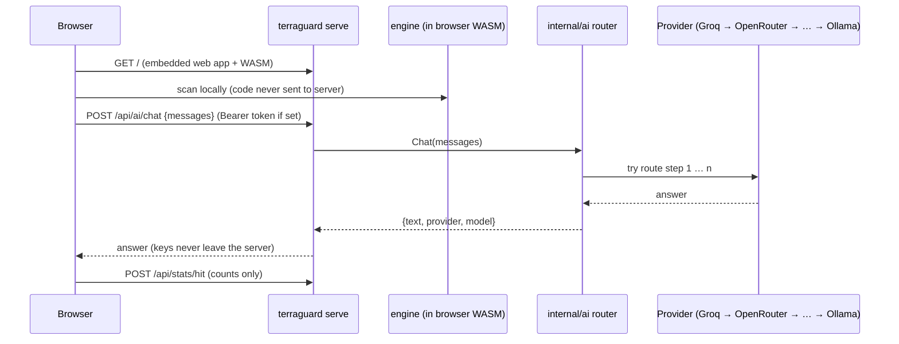

---

## 4. Engine internals (LLD)

### 4.1 Data model

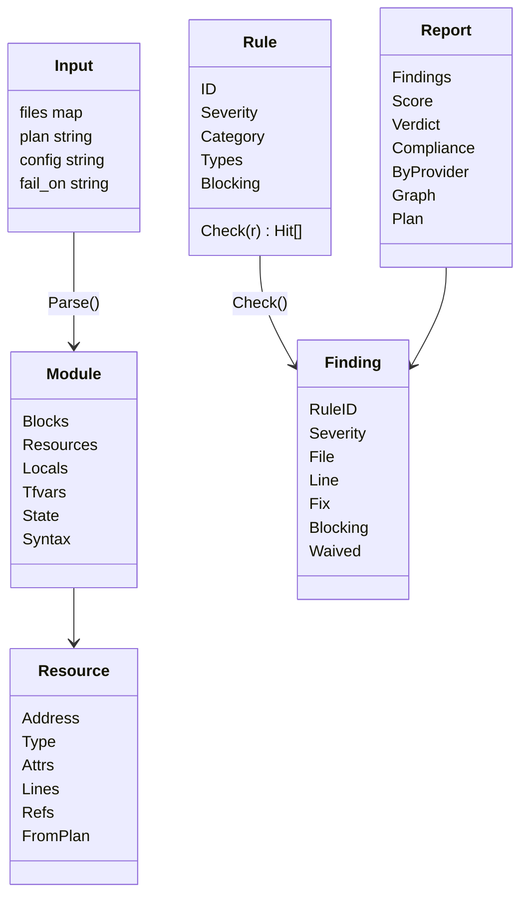

**Key idea: one normalized `Resource`.** HCL attributes are evaluated into plain
values. Nested blocks become lists, and non-literal expressions become
`Unknown{Expr}`. Plan JSON `after` values have the same shape, so each rule is
written once and runs on both source code and resolved plan values.

### 4.2 Scan pipeline

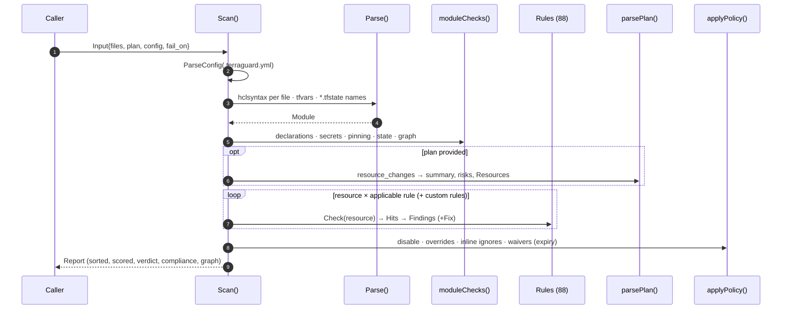

### 4.3 Parsing details

| Concern | How it's handled |
|---|---|
| Parser | `hashicorp/hcl/v2/hclsyntax`, Terraform's own parser, so line numbers are exact |
| Expressions | Evaluated with every referenced root set to `cty.DynamicVal`, so a list can be partly known |
| `jsonencode({...})` | The argument object is kept as structure, so IAM statements stay inspectable even with ARN references |
| References | Scope-aware for `for` expressions. `dynamic` iterators are excluded. `provider`/`lifecycle` are skipped |
| Errors | Syntax errors are blocking findings per file. Other files are still analyzed |

### 4.4 Scoring, verdict and gate

- **Score** starts at 100 and subtracts per active finding: Critical 20, High 8, Medium 3, Low 1. Grades: A ≥ 90, B ≥ 75, C ≥ 60, D ≥ 40, F below.
- **Verdict ("will it apply?")** is false if any active finding is `Blocking`.
- **Gate** fails on any blocking finding, or on any active finding at or above `fail_on`.

### 4.5 Autofix

Fixes target a block address and an attribute path (for example
`resource.aws_db_instance.main` + `storage_encrypted`), not line numbers. They
are applied with `hclwrite`, which creates missing nested blocks and keeps
comments. Fixes that force replacement say so.

---

## 5. Cloud coverage

| Provider | Examples of what's checked |
|---|---|
| **AWS** | S3 ACL/BPA/versioning, SG exposure, RDS public/unencrypted/backups, IAM wildcards & `Principal "*"`, AdministratorAccess, KMS rotation, CloudTrail, EBS, IMDSv2, EKS endpoint, Lambda URL auth, **deprecated Lambda runtimes**, ALB/CloudFront TLS, SQS/SNS, ECR, ElastiCache/OpenSearch, VPC flow logs, Route 53 DNSSEC |
| **Google Cloud** | GCS public/UBLA, firewall exposure, Cloud SQL authorized networks & SSL, primitive/public IAM, GKE ABAC & master networks, default SA scopes, Cloud DNS DNSSEC |
| **Azure** | Storage TLS/public, NSG exposure, Key Vault purge protection, SQL/Postgres/MySQL firewall, AKS public API/RBAC, CDN/Front Door HTTP |
| **Cloudflare** | SSL mode, min TLS, HTTPS redirect, security level, DNS-only records, Worker plain-text secrets, zone DNSSEC |
| **DigitalOcean** | Firewall exposure, public Spaces, databases without trusted sources, droplets without SSH keys |
| **Hetzner** | Firewall exposure, servers with no firewall |
| **Akamai/Linode** | `inbound_policy = ACCEPT`, open inbound rules |
| **OVHcloud / OpenStack** | Security group rules open to the internet, managed DB IP restrictions |
| **Oracle Cloud** | Security lists / NSG rules, public buckets |
| **Alibaba Cloud** | Security group rules, public OSS |
| **Vultr** | Firewall rules |
| **Kubernetes / Helm** | Privileged / host-namespace pods, mutable images, open LoadBalancers, plain-text secrets, unpinned charts |
| **Any provider** | Syntax/references/duplicates, CIDRs, hardcoded secrets & key patterns, provider/module pinning, `required_version`, state backend, committed state, subdomain-takeover CNAMEs, cost |

Run `terraguard rules` for the full catalog of 88 rules.

---

## 6. AI: optional, advisory, with fallback routing

**Is an LLM needed? No.** It only produces responses and suggestions:
explaining findings, remediation plans, file rewrites, generating modules and
`terraform test` files, cost review, provider-upgrade help, plan explanations,
and a "deep review" whose results are labelled **AI suggestion**. It never
decides pass/fail.

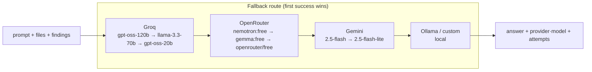

| Concern | Behaviour |
|---|---|
| Rate limit / outage / timeout / retired model | Next model, then next provider |
| Bad key (401/403) | Skip the rest of that provider |
| `TERRAGUARD_AI_LOCAL_ONLY=true` / browser **Private mode** | Hosted providers removed from the route |
| `TERRAGUARD_AI_ROUTE` | Explicit chain, e.g. `groq:openai/gpt-oss-120b,openrouter,ollama` |
| Errors | Key-shaped strings redacted before logging or display |

| Provider | Free key |
|---|---|
| Groq | https://console.groq.com/keys |
| OpenRouter | https://openrouter.ai/keys |
| Google Gemini | https://aistudio.google.com/apikey |
| Ollama (local) | https://ollama.com/download |

`evals/llm_eval.py` benchmarks any provider against the same labelled cases
as the engine, which is the evidence for keeping the LLM out of the gate.

---

## 7. Pipelines

### 7.1 Pipelines in *your* Terraform repo (generated by the CI/CD tab)

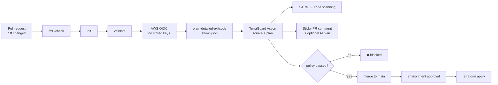

- **Triggers:** PRs and pushes touching `**/*.tf`, `**/*.tfvars` or `.terraguard.yml`. Pipelines in your other projects are never triggered.
- **Opt-in only:** drift detection (scheduled) and apply-on-merge.
- **Concurrency:** a running apply is never cancelled.

### 7.2 Pipelines in *this* repo: path-filtered, no cron

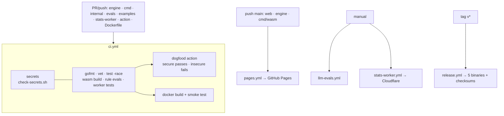

| Workflow | Runs when | Approx. time |
|---|---|---|
| `ci.yml` | Go / evals / worker / action / Dockerfile changes | 2–4 min |
| `pages.yml` | Site or engine changes on `main` | ~1 min |
| `llm-evals.yml` | Manual | ~2 min (your free key) |
| `stats-worker.yml` | Manual | ~1 min |
| `release.yml` | `v*` tag | ~1 min |

---

## 8. Live stats dashboard

Public, anonymous counters show how much Terraform is being evaluated:
evaluations, **Terraform files checked**, resources analyzed, issues found,
auto-fixes and AI answers, for today, the last 7 days and all time. The
dashboard also shows how many people are active right now, what's executing
on the server, where scans ran, and the most common issues.

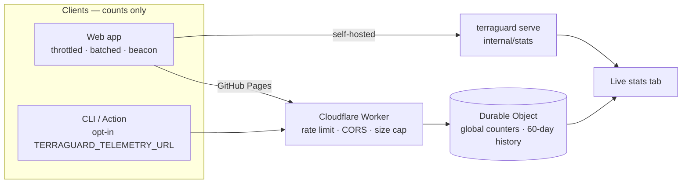

| Counted | Never counted |
|---|---|
| Number of evaluations, files, resources, findings, fixes, AI answers; rule IDs; surface; a random per-tab session ID for "active now" | Code, file names, resource names, IP addresses (rate-limit buckets live only in memory), keys |

Not counted when: Do-Not-Track or Global Privacy Control is on, Private mode is on, or the user unticks the setting. CLI and Action are counted only when opted in.

---

## 9. Policy-as-code, waivers and compliance

```yaml
# .terraguard.yml
fail_on: HIGH
disable: [TG-CF-002]
severity_overrides:
  TG-AWS-EC2-001: HIGH
waivers:
  - rule: TG-AWS-S3-001
    resource: "aws_s3_bucket.public_site"
    reason: "Static website, intentionally public"
    expires: "2026-12-31"          # expired → finding returns + TG-POL-001
    approved_by: platform-team
custom_rules:
  - id: ORG-TAG-001
    title: Resources must declare an owner tag
    resource_types: ["aws_*"]
    attribute: tags.owner
    exists: true                   # also: equals, not_equals, in, not_in, matches
```

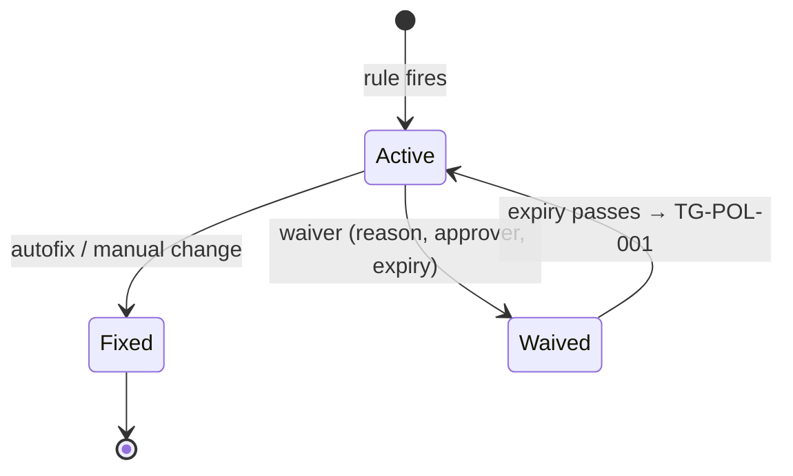

**Compliance mapping (indicative).** Each rule maps to control themes
(encryption at rest/in transit, network exposure, access control, secrets,
logging, backup, change/supply-chain). The themes map to **CIS Controls v8,
SOC 2, PCI DSS v4.0, ISO/IEC 27001:2022 and HIPAA**. A control "fails" when
an active finding is evidence against it. This helps prepare for audits; it
is not a certification.

---

## 10. Security, privacy and secrets

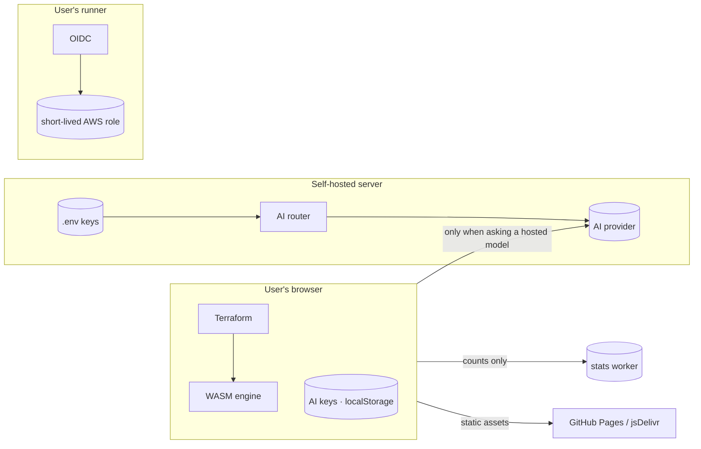

- No TerraGuard-operated backend sees code. The only optional shared service stores counts.
- **Keys:** stored only in `.env`, CI secrets or browser `localStorage`, and sent only to their provider. `/api/config` returns provider and model names only. Errors pass through `Redact()`. `.dockerignore` excludes `.env`.
- **Repository:** `scripts/check-secrets.sh` runs in CI and as a pre-commit hook, and fails on any tracked key or `.env`.
- **Server:** binds to `127.0.0.1` by default and warns when exposed without `TERRAGUARD_SERVER_TOKEN`. The token is compared in constant time, request bodies are capped at 5 MB, and the Docker image is distroless, non-root and read-only.
- **LLM output** is sanitized with DOMPurify, and AI code is applied only on click.
- An invalid `.terraguard.yml` makes the CLI exit 2 instead of silently using defaults.

Full self-hosting and privacy guide: [SELF_HOSTING.md](SELF_HOSTING.md).

---

## 11. Quality: tests and evals

| Layer | Command | What it proves |
|---|---|---|
| Engine unit tests | `make test` | Examples, the clean secure project, autofix round-trip, plan, ignores, scoping, custom rules, SARIF, fail-on override |
| AI router tests | `make test` | `.env` parsing, route order and overrides, fallback on 429, skip on 401, local-only, key redaction |
| Server tests | `make test` | `/api/config` never exposes keys, stats never contain code, token auth |
| Rule evals | `make evals` | 43 labelled cases (`# expect:` / `# forbid:`). CI fails on any miss or false positive |
| Worker tests | `make worker-test` | Clamping, history pruning, never storing code |
| LLM benchmark | `python3 evals/llm_eval.py --provider groq` | Recall and precision of an LLM-only reviewer on the same cases |
| Dogfood | `ci.yml` | The action passes the secure example and fails the insecure one; the Docker image serves the app |

---

## 12. Repository layout

| Path | Contents |
|---|---|
| `engine/` | Parser, rules (`rules.go`, `rules_clouds.go`), module/graph checks, plan, policy, compliance, docs, autofix, formats |
| `internal/ai/` | Provider router, fallback, `.env` loader, redaction |
| `internal/stats/` | Anonymous counters for `terraguard serve` |
| `cmd/terraguard/` | CLI, MCP server, self-hosted server |
| `cmd/wasm/` | Browser bridge |
| `web/` | Static app (also embedded into the server binary) |
| `stats-worker/` | Cloudflare Worker + Durable Object for public counters |
| `action.yml` | Composite GitHub Action |
| `evals/` | Labelled cases, rule gate, LLM benchmark |
| `examples/` | Insecure, multi-cloud and secure projects; sample plan |
| `scripts/` | `check-secrets.sh` |
| `Dockerfile`, `docker-compose.yml` | Self-hosting (optional bundled Ollama) |

---

## 13. Design decisions

| Decision | Alternatives | Why |
|---|---|---|
| Go engine → WASM + CLI + server | Python backend (previous Flask design), JS rewrite | Terraform's own parser, one codebase for five surfaces, no server needed |
| Deterministic gate, LLM advisory | LLM-only analysis (previous design) | Reproducible, free, offline, measurable; LLM answers vary and can hallucinate (see `llm_eval.py`) |
| Normalized `Resource` model | Separate rules for source and plan | Each rule written once, covering code and resolved plan values |
| Multi-model, multi-provider fallback | Single provider | Free tiers rate-limit and retire models monthly; the user still gets an answer |
| BYOK in the browser, `.env` on the server | Shared hosted key | No key to leak or rate-limit, users control spend, private mode is possible |
| Cloudflare Worker + Durable Object for counters | No stats, or a database server | Free, serverless, strongly consistent single counter, no PII |
| Path-filtered workflows, no cron | Scheduled scans | Saves CI minutes and doesn't trigger other pipelines |
| `hclwrite` autofix | Regex | Edits the syntax tree, so comments survive and nested blocks are created correctly |

---

## 14. Roadmap

Contributions are welcome. See [CONTRIBUTING.md](../CONTRIBUTING.md).

- `.tf.json` input and module-aware analysis (follow `./modules/x` with their inputs).
- SARIF `fixes` so GitHub suggests the auto-fix inline.
- Cost estimates from public pricing for plan changes.
- More providers: Scaleway, Exoscale, IBM Cloud, Fastly, Datadog.
- VS Code extension using the same WASM engine.
- OPA/Rego import for existing policy libraries.
