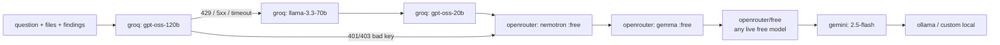
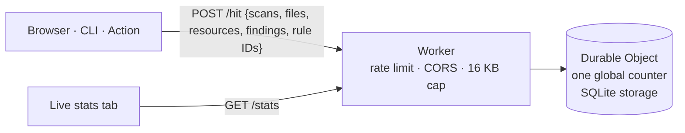

# Self-hosting and private AI

TerraGuard runs in four modes. Pick the one that matches how private your
code has to stay.

| Mode | Where the engine runs | Where AI runs | Code leaves your machine? |
|---|---|---|---|
| **Web app (GitHub Pages)** | Your browser (WASM) | Off, a provider you pick, or a local model | Only if you use a hosted AI model |
| **CLI / GitHub Action** | Your laptop / your runner | Off, or `.env` keys | Only if you add `--ai` with a hosted provider |
| **Self-hosted server** | Your server | Server-side `.env` keys, or local model | Only to the AI provider you configure |
| **Fully private** | Your machine / network | Ollama / LM Studio / vLLM | **Never** |

The engine never needs a network connection or a key. Scanning, validation,
plan analysis, auto-fix, policy, compliance and docs all run without AI.

---

## 1. Fully private in 3 commands (no data leaves your machine)

```bash
# 1. a local model (https://ollama.com/download)
ollama pull llama3.2                     # or qwen2.5-coder, mistral, llama3.1:70b …

# 2. TerraGuard
git clone https://github.com/Karthik-099/TERRAGUARD && cd TERRAGUARD
cat > .env <<'ENV'
TERRAGUARD_OLLAMA_URL=http://localhost:11434/v1
TERRAGUARD_OLLAMA_MODEL=llama3.2
TERRAGUARD_AI_LOCAL_ONLY=true
ENV

# 3. run it
make serve                               # → http://127.0.0.1:8080
```

Check the route TerraGuard will use:

```bash
bin/terraguard ai
# mode: local-only (hosted providers disabled)
#   1. ollama:llama3.2
```

In the web UI, open **AI settings**, choose **Self-hosted TerraGuard server**,
and tick **Private mode**. With private mode on, hosted providers are
disabled in the browser as well.

**Using the public web app with a local model instead.** Start Ollama with the
site's origin allowed, then pick **Local model** in AI settings:

```bash
OLLAMA_ORIGINS=https://karthik-099.github.io ollama serve
```

**No model at all?** Leave every AI setting empty. All other features keep
working, and the UI says "AI off".

---

## 2. Docker (team server)

```bash
cp .env.example .env                   # add keys, or nothing
docker compose up -d                   # http://127.0.0.1:8080

# private: bundled Ollama, nothing leaves your network
docker compose --profile local-llm up -d
docker compose exec ollama ollama pull llama3.2
echo "TERRAGUARD_AI_LOCAL_ONLY=true" >> .env && docker compose up -d
```

The image is distroless, runs as non-root with a read-only filesystem, and is
published only on `127.0.0.1`. To share it with your team, put it behind your
SSO proxy (Cloudflare Access, oauth2-proxy, an internal ingress) **and** set
`TERRAGUARD_SERVER_TOKEN`. Without a token, anyone who can reach the port can
spend your AI quota.

### Server API

| Endpoint | Purpose |
|---|---|
| `GET /` | The web app (embedded) |
| `GET /api/config` | Version and AI route (provider:model names only, never keys) |
| `POST /api/scan` | `{"files": {...}, "plan": "...", "config": "..."}` → report |
| `POST /api/fix` | Same input → fixed files |
| `POST /api/ai/chat` | `{"messages": [...]}` → answer via the fallback route |
| `GET /api/stats` | Anonymous usage counters for the dashboard |
| `GET /healthz` | Liveness |

`/api/scan`, `/api/fix` and `/api/ai/chat` require `Authorization: Bearer $TERRAGUARD_SERVER_TOKEN` when the token is set.

---

## 3. AI fallback routing

TerraGuard tries each step in order until one answers:



- Rate limits, outages, timeouts and retired models fall through to the next model, then to the next provider.
- A rejected key (401/403) skips the rest of that provider's models.
- `TERRAGUARD_AI_LOCAL_ONLY=true` drops every hosted step.
- Override the order with `TERRAGUARD_AI_PROVIDER=openrouter`, or set it explicitly with
  `TERRAGUARD_AI_ROUTE=groq:openai/gpt-oss-120b,openrouter,ollama`.
- The browser does the same per provider, and also falls back across the providers you've configured.

---

## 4. Secrets: what goes where

| Secret | Lives in | Sent to | Never |
|---|---|---|---|
| AI keys (CLI/server) | `.env` (git-ignored) or CI secrets | Only that provider's API | Logged, returned by `/api/config`, embedded in the image, shown in errors (redacted) |
| AI keys (browser) | That browser's `localStorage` | Only that provider's API | Sent to TerraGuard or any other server |
| `TERRAGUARD_SERVER_TOKEN` | Server env; user's browser | Your server | Logged |
| Your Terraform | Your editor / repo | Hosted AI provider only if you ask a hosted model | Stats, telemetry, share links to any server |

Guards in the code:

- `internal/ai.Redact` masks anything key-shaped in provider errors before they reach logs, PR comments or the UI.
- `scripts/check-secrets.sh` runs in CI (and as a pre-commit hook) and fails the build if any credential, or a `.env` file, is tracked by git.
- `.dockerignore` keeps `.env` out of images, and `web/` (the embedded site) never contains keys.
- Uploaded `*.tfstate` files are flagged (TG-STATE-002) and never loaded into the editor.

Enable the pre-commit hook:

```bash
ln -s ../../scripts/check-secrets.sh .git/hooks/pre-commit
```

---

## Public usage dashboard

The **Live stats** tab shows evaluations, Terraform files checked, resources
analyzed, issues found, auto-fixes and AI answers, for today, the last 7 days
and all time. It also shows how many people are active right now and where
scans ran (web, CLI, Action).

Only **anonymous numbers** are counted: never code, file names, resource
names, IP addresses or keys. Browsers with Do-Not-Track / Global Privacy
Control, private mode, and users who untick the setting are never counted.
CLI and Action usage is counted only if you set `TERRAGUARD_TELEMETRY_URL`.

| Where | Backend |
|---|---|
| Self-hosted | Built in: `terraguard serve` serves `/api/stats` (in-memory) |
| GitHub Pages | `stats-worker/`: a Cloudflare Worker + Durable Object on the free plan |

Deploy the public counters:

```bash
cd stats-worker
npm test
npx wrangler login
npx wrangler deploy            # prints https://terraguard-stats.<you>.workers.dev
```

Then set `statsUrl` in `web/config.js` to that URL and push. The Pages
workflow redeploys the site. To deploy from CI instead, add
`CLOUDFLARE_API_TOKEN` and `CLOUDFLARE_ACCOUNT_ID` secrets and run the
**stats-worker** workflow (manual only).



---

## GitHub Discussions on the site

1. On the repo, go to **Settings → General → Features → Discussions**.
2. Install the [giscus app](https://github.com/apps/giscus) on the repo.
3. On [giscus.app](https://giscus.app), copy `data-repo-id` and `data-category-id`.
4. Paste them into `giscus` in `web/config.js` and push.

Comments then appear in the **Community** tab, and the GitHub stars, forks,
contributors and issues are shown live from the public GitHub API.
